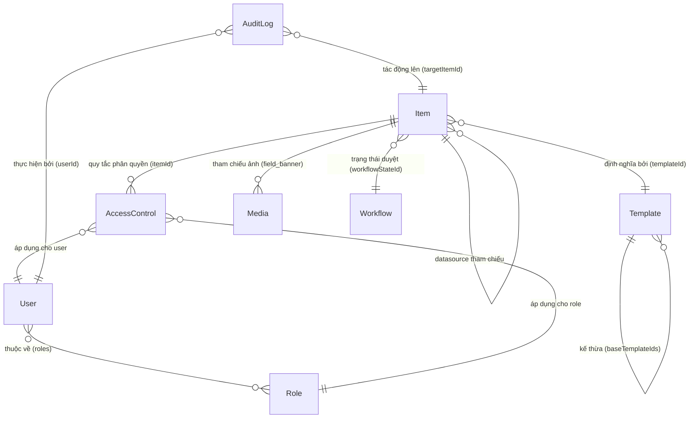

# Mô hình Dữ liệu Tổng quát (Data Model Overview)
> File: `docs/data-model/README.md`  
> Mô tả: Sơ đồ quan hệ thực thể, chiến lược lưu trữ cây phân cấp và bảng tra cứu tài liệu data model chi tiết.

---

## 1. Sơ đồ Quan hệ Tổng quát (Entity Relationship Diagram)

---

## 2. Chiến lược Lưu trữ Cây nội dung: Materialized Path + Ancestors Array
Để đáp ứng đồng thời 3 yêu cầu hiệu năng cao:
1. **Lazy Loading 1 cấp mượt mà:** Tìm các con trực tiếp nhanh nhất:
   `db.items_master.find({ parentId: currentId, deleted: false }).sort({ sortOrder: 1 })`
2. **Truy vấn toàn bộ nhánh cây con:** Tìm mọi con cháu bên dưới nhanh chóng khi di chuyển (move), xóa (delete), hoặc publish cả nhánh:
   `db.items_master.find({ path: { $regex: '^/root/content/home' } })`
3. **Kế thừa quyền và tính toán đường dẫn:** Kiểm tra nhanh danh sách tổ tiên mà không cần đệ quy truy vấn nhiều lần:
   `db.items_master.find({ _id: { $in: item.ancestors } })`

Mô hình kết hợp 3 trường khóa trên mỗi Item:
- `parentId`: ID của node cha trực tiếp (`null` đối với Root node `/root`).
- `path`: Đường dẫn chuỗi văn bản duy nhất (ví dụ: `/root/content/home/about-us`).
- `ancestors`: Mảng chứa danh sách `ObjectId` của toàn bộ tổ tiên từ trên xuống dưới theo thứ tự phân cấp.

---

## 3. Bảng Tra cứu Tài liệu Mô hình Dữ liệu Chi tiết

| Miền dữ liệu / Collection | File tài liệu chi tiết | Mô tả tóm tắt |
| :--- | :--- | :--- |
| `items_master`, `items_web` | [`items-and-tree.md`](./items-and-tree.md) | Cấu trúc node Item, cây nội dung, Materialized Path, indexes |
| `templates` | [`templates.md`](./templates.md) | Schema định nghĩa trường, sections, fields, kế thừa base templates, standard values, insert options |
| `languages`, `versions` | [`versions-languages.md`](./versions-languages.md) | Đa ngôn ngữ, đa phiên bản, phân định 3 cấp: Shared, Unversioned, Versioned |
| `presentation` (Item & Template) | [`presentation.md`](./presentation.md) | Cấu trúc Shared & Final Layout, Standard Presentation, System Templates (`/root/layout/*`), UID UUID v4 |
| `users`, `roles`, `access_control_lists` | [`users-roles-acl.md`](./users-roles-acl.md) | Tài khoản, vai trò, bảng phân quyền ACL theo Item và thuật toán đánh giá quyền |
| `media` | [`media.md`](./media.md) | Tệp tin đa phương tiện, thư mục media, thumbnails và metadata |
| `workflows`, `audit_logs`, `publish_histories` | [`workflow-publish-audit.md`](./workflow-publish-audit.md) | Trạng thái workflow, lịch sử kiểm toán audit logs, nhật ký publish Master sang Web |

