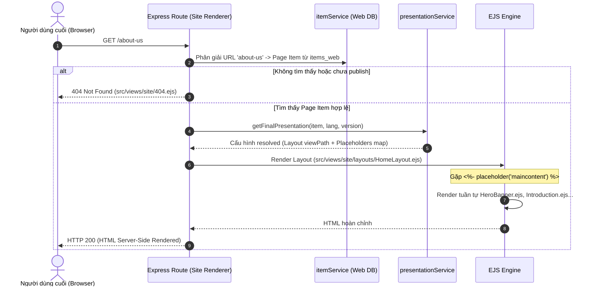

# Mô hình Cấu hình Presentation (Server-Side EJS)
> File: `docs/data-model/presentation.md`  
> Mô tả: Cấu trúc Presentation trên Item (Shared & Final), Standard Presentation trên Page Template, System Templates, 3 thư mục con của Cây Layout và quy tắc bảo mật `viewPath`.

---

## 1. Cấu trúc `presentation` trên Item (`items_master` và `items_web`)
Trong kiến trúc Server-Side EJS, cấu trúc Presentation được tinh gọn, **loại bỏ hoàn toàn khái niệm Device**:

```javascript
// Nằm bên trong document Item (collection items_master và items_web)
presentation: {
  // 1. Shared Layout: Dùng chung cho mọi ngôn ngữ và mọi phiên bản của Item
  shared: {
    layoutId: ObjectId("64a1b2c3d4e5f67890123910"), // Tham chiếu item Layout trong /sitecore/layout/Layouts
    renderings: [
      {
        uid: "b8a5d448-6a3f-4e09-9154-1b12b5f63d33", // UUID v4 bất biến cho mỗi rendering instance
        renderingId: ObjectId("64a1b2c3d4e5f67890123920"), // Tham chiếu item Rendering trong /sitecore/layout/Renderings
        placeholder: "maincontent",  // Khóa placeholder (header, maincontent, footer...)
        sortOrder: 100,              // Thứ tự render tuần tự trong placeholder
        datasourceId: null,          // Tùy chọn: ID item nguồn dữ liệu (nếu null, component đọc field trực tiếp từ chính page item)
        parameters: {                // Tùy chọn: Tham số cấu hình giao diện
          "theme": "dark",
          "fullWidth": "true"
        }
      },
      {
        uid: "f2c3d4e5-6a3f-4e09-9154-1b12b5f63d99",
        renderingId: ObjectId("64a1b2c3d4e5f67890123921"), // Rendering Introduction
        placeholder: "maincontent",
        sortOrder: 200,
        datasourceId: null,
        parameters: {}
      }
    ]
  },
  
  // 2. Final Layout: Ghi đè (Delta Override) theo từng cặp [ngôn ngữ + phiên bản] cụ thể
  final: [
    {
      language: "vi",
      version: 1,
      layoutId: null, // null = kế thừa layoutId từ shared
      renderings: [
        // Mảng rendering override cho phiên bản/ngôn ngữ này: thêm mới, đổi thứ tự, đổi datasource
      ]
    }
  ]
}
```

---

## 2. Standard Presentation trên `Template`
Được định nghĩa trong Schema `Template` (tại `src/models/Template.js`) dành cho các **Page Template** tại nhánh `/sitecore/templates/Project/Pages/`:

```javascript
presentation: {
  layoutId: ObjectId("64a1b2c3d4e5f67890123910"), // Layout mặc định (ví dụ HomeLayout)
  renderings: [
    {
      uid: "c194e432-8495-46aa-a982-f04bbf63e001",
      renderingId: ObjectId("64a1b2c3d4e5f67890123920"), // HeroBanner
      placeholder: "maincontent",
      sortOrder: 100,
      datasourceId: null,
      parameters: {}
    },
    {
      uid: "d205f543-9506-57bb-b093-015ccf74f002",
      renderingId: ObjectId("64a1b2c3d4e5f67890123921"), // Introduction
      placeholder: "maincontent",
      sortOrder: 200,
      datasourceId: null,
      parameters: {}
    }
  ]
}
```

### Mối quan hệ Rendering $\leftrightarrow$ Component Template & Cơ chế Suy ra Trường (DEC-036):
- Mỗi **Component Template** (nằm tại `/sitecore/templates/Feature/Components/`, ví dụ `HeroBanner`, `Introduction`) định nghĩa các trường nội dung riêng của component đó.
- Mỗi **Rendering Item** (nằm tại `/sitecore/layout/Renderings/`) gắn trực tiếp với một Component Template thông qua thuộc tính **`componentTemplate`**.
- Mỗi **Page Template** (nằm tại `/sitecore/templates/Project/Pages/`, ví dụ `Home`, `About us`):
  1. Cấu hình **Standard Presentation**: Chọn layout (`HomeLayout`) và các rendering (`HeroBanner`, `Introduction`, `ImageText`) gắn vào các placeholder (`maincontent`).
  2. **Không** cấu hình Base Templates trỏ tới Component Templates. Page Template hoàn toàn độc lập với các component.
  3. Khi biên tập viên tạo một trang mới hoặc mở trang trên Content Editor, hàm `templateService.resolveEffectiveTemplate` tự động suy ra danh sách trường của tất cả component xuất hiện trong Presentation và nhóm thành các Section riêng biệt (`HeroBanner`, `Introduction`...) trên form.
  4. Dữ liệu được lưu trữ theo `fieldId`. Nếu gỡ rendering khỏi presentation, trường của component chỉ ẩn đi; dữ liệu cũ vẫn nguyên vẹn và sẽ xuất hiện lại nếu thêm lại rendering.

---

## 3. Cấu trúc Cây `/sitecore/layout/` (Đúng 3 Thư mục con)
Nhánh `/sitecore/layout/` được chuẩn hóa thành **đúng 3 thư mục con bất biến**:

```text
/sitecore/layout/
├── Layouts/              # Chứa các item Layout
│   └── HomeLayout        # viewPath: "layouts/HomeLayout.ejs"
├── Placeholders/         # Chứa các item Placeholder giữ chỗ
│   ├── header            # placeholderKey: "header"
│   ├── maincontent       # placeholderKey: "maincontent"
│   └── footer            # placeholderKey: "footer"
└── Renderings/           # Chứa các item Rendering (Component)
    ├── HeroBanner        # viewPath: "components/HeroBanner.ejs", componentTemplate: HeroBanner
    ├── Introduction      # viewPath: "components/Introduction.ejs", componentTemplate: Introduction
    └── ImageText         # viewPath: "components/ImageText.ejs", componentTemplate: ImageText
```

> [!IMPORTANT]
> - **Không có thư mục `Devices`** và **không có thư mục `Placeholder Settings`**.
> - Các thư mục con bên trong có thể lồng nhiều cấp để nhóm theo tính năng (ví dụ `Renderings/Feature/...`, `Renderings/Foundation/...`).
> - Mọi tham chiếu giữa Item, Layout, Placeholder, Rendering đều thực hiện bằng **ObjectId**, không phụ thuộc vào đường dẫn chuỗi (path).

---

## 4. Các Template Hệ thống cho Presentation (System Templates)
Được định nghĩa tại nhánh cây `/sitecore/templates/System/Layout/`:

1. **Template `Layout`:**
   - Trường `name`, `displayName`.
   - Trường **`viewPath`** (Single-Line Text, bắt buộc): Đường dẫn tương đối tới file EJS tính từ `src/views/site/` (ví dụ `layouts/HomeLayout.ejs`).
   - `placeholders` (mảng string các placeholder mà layout này cung cấp: `["header", "maincontent", "footer"]`).
2. **Template `Placeholder`:**
   - Trường `name`, `displayName`.
   - Trường **`placeholderKey`** (Single-Line Text, bắt buộc): Khóa placeholder xuất hiện trong code layout EJS (ví dụ `header`, `maincontent`, `footer`).
   - Trường **`allowedRenderings`** (Multilist / Array of ObjectId): Danh sách các Rendering được phép thêm vào placeholder này. Nếu để trống, cho phép toàn bộ Rendering.
3. **Template `Rendering`:**
   - Trường `name`, `displayName`, `icon`.
   - Trường **`viewPath`** (Single-Line Text, bắt buộc): Đường dẫn tương đối tới file EJS tính từ `src/views/site/` (ví dụ `components/HeroBanner.ejs`).
   - Trường **`componentTemplate`** (ObjectId, bắt buộc): Trỏ tới Template chứa các trường nội dung tương ứng của component tại `/sitecore/templates/Feature/Components` (sử dụng ItemPicker hoặc select picker lọc theo gốc).
   - Trường `parametersTemplate` (ObjectId, tùy chọn): Trỏ tới Template định nghĩa tham số giao diện (ví dụ màu nền, căn lề).
4. **Template `Layout Folder` & `Rendering Folder` & `Placeholder Folder`:**
   - Dùng để tổ chức cây thư mục con phân cấp dưới `/sitecore/layout/`.

---

## 5. Cơ chế Render Trang Công Khai (Site Renderer Engine)
Khi người dùng truy cập một URL công khai (ví dụ `GET /about-us`):



### Helper `placeholder(key)` trong Layout EJS:
Trong file layout (ví dụ `src/views/site/layouts/HomeLayout.ejs`):
```html
<!DOCTYPE html>
<html lang="<%= lang %>">
<head>
  <%- include('../partials/head') %>
  <title><%= fields.metaTitle || item.displayName || item.name %></title>
</head>
<body>
  <header>
    <%- placeholder('header') %>
  </header>

  <main id="main">
    <%- placeholder('maincontent') %>
  </main>

  <footer>
    <%- placeholder('footer') %>
  </footer>
</body>
</html>
```

### Ngữ cảnh truyền vào từng Component EJS:
Mỗi file component EJS (ví dụ `src/views/site/components/HeroBanner.ejs`) nhận được:
- `item`: Document page item hiện tại.
- `fields`: Object chứa các trường dữ liệu của item đã được resolved theo ngôn ngữ, phiên bản và standard values (đã qua xử lý `resolveRichText` và media URL).
- `params`: Object tham số cấu hình riêng của rendering instance.
- `datasource`: Dữ liệu của datasource item (nếu rendering có cấu hình `datasourceId` riêng).
- `site`: Thông tin ngữ cảnh website (tên site, startItem).
- `lang`: Mã ngôn ngữ hiện tại (`vi`, `en`).

---

## 6. Quy tắc Toàn vẹn & Bảo mật `viewPath`
1. **Định danh Rendering Instance bằng UUID v4:** Mọi rendering instance bắt buộc mang một `uid` chuẩn **UUID v4** duy nhất, không đổi khi sắp xếp hay di chuyển giữa các placeholder.
2. **Bảo vệ Node Hệ thống:** Ba node `/sitecore/layout/Layouts`, `/sitecore/layout/Placeholders`, `/sitecore/layout/Renderings` là node hệ thống bất biến, cấm xóa, đổi tên hoặc di chuyển.
3. **Bảo mật `viewPath` (DEC-033):**
   - Chỉ chấp nhận đường dẫn tương đối nằm bên trong thư mục `src/views/site/`.
   - Chặn tuyệt đối ký tự `..` và bắt buộc có đuôi mở rộng `.ejs`.
   - Kiểm tra tệp tin thực tế trên đĩa khi lưu trong Content Editor.
4. **Kiểm tra Ràng buộc Trước khi Xóa:**
   - Không cho phép xóa một Layout, Placeholder hoặc Rendering nếu đang được sử dụng trong Standard Presentation của bất kỳ Template nào hoặc trong Presentation của bất kỳ Item nào.
