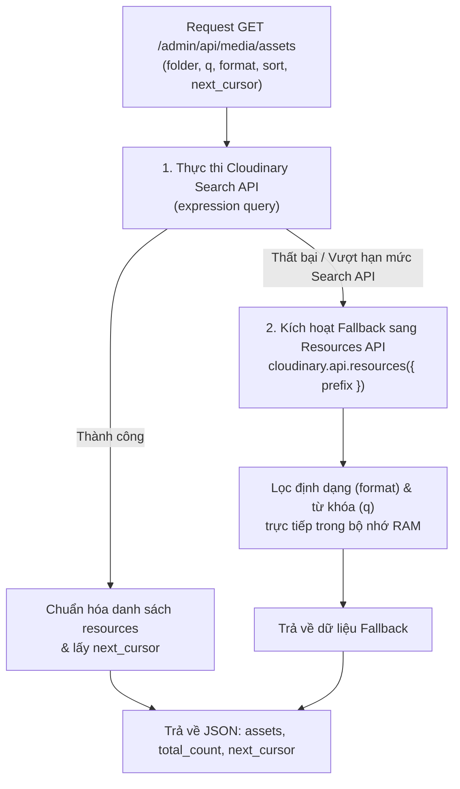

# Media Storage & Backend Architecture – Tích Hợp Cloudinary

Tài liệu này đặc tả chi tiết tầng lưu trữ (Storage Layer) và kiến trúc Backend quản lý tệp tin đa phương tiện trong hệ thống, dựa trên mã nguồn thực tế tại `utils/cloudinary.js`, `routes/index.js`, và `controllers/indexController.js`.

---

## 1. Cấu Hình SDK & Cơ Chế Xác Thực (Authentication & SDK Setup)

Hệ thống sử dụng **Cloudinary Node.js SDK v2** (`cloudinary@^1.41.0`) kết hợp với **Multer Storage Cloudinary** (`multer-storage-cloudinary@^4.0.0`).

### 1.1. Khởi Tạo SDK (`utils/cloudinary.js`)
```javascript
const cloudinary = require('cloudinary').v2;

cloudinary.config({
  cloud_name: process.env.CLOUDINARY_CLOUD_NAME,
  api_key: process.env.CLOUDINARY_API_KEY,
  api_secret: process.env.CLOUDINARY_API_SECRET,
  secure: true,      // Bắt buộc phân phối qua giao thức bảo mật HTTPS
  timeout: 120000    // Timeout 120 giây cho các tệp tin dung lượng lớn
});

const DEFAULT_ROOT_FOLDER = (process.env.CLOUDINARY_API_FOLDER || 'Blog').replace(/^\/+|\/+$/g, '');
```

### 1.2. Cơ Chế Xác Thực (Signature & Security)
- **Hoàn toàn bảo mật phía Máy chủ (Server-side Authentication)**: Toàn bộ quá trình upload, tìm kiếm, tạo/xóa thư mục và xóa ảnh đều được ký số (signed) và thực hiện thông qua backend Node.js bằng `api_key` và `api_secret`.
- **Không để lộ Client Upload Preset**: Hệ thống **không** mở tính năng `unsigned upload` ra ngoài client browser. Mọi request tải ảnh từ browser đều phải gửi tới endpoint nội bộ của server (`/admin/api/media/upload`), nơi có middleware kiểm tra phiên đăng nhập của Admin trước khi được ủy quyền gửi tiếp lên Cloudinary.

---

## 2. Cấu Hình Multer Storage & Quy Trình Biến Đổi Ảnh (Storage Engine)

### 2.1. Cấu Trúc Đặt Tên & Thư Mục Đích (`CloudinaryStorage`)
```javascript
const storage = new CloudinaryStorage({
  cloudinary,
  params: async (req, file) => {
    // 1. Xác định thư mục đích từ req.body hoặc req.query, mặc định là DEFAULT_ROOT_FOLDER
    let targetFolder = req.body?.folder || req.query?.folder || DEFAULT_ROOT_FOLDER;
    targetFolder = targetFolder.replace(/^\/+|\/+$/g, '');
    
    // Đảm bảo đường dẫn luôn nằm trong thư mục gốc được cấp phép (Sandbox folder path)
    if (!targetFolder.startsWith(DEFAULT_ROOT_FOLDER)) {
      targetFolder = `${DEFAULT_ROOT_FOLDER}/${targetFolder}`.replace(/\/+/g, '/');
    }

    // 2. Làm sạch tên file gốc (Sanitize filename)
    const name = (file.originalname || 'image')
      .replace(/\.[^/.]+$/, '')
      .replace(/[^a-zA-Z0-9_-]/g, '_');

    return {
      folder: targetFolder,
      allowed_formats: ['jpg', 'jpeg', 'png', 'gif', 'webp', 'svg'],
      
      // 3. Tự động chuẩn hóa và nén ảnh trên Cloudinary CDN
      transformation: [
        {
          width: 1600,
          height: 1600,
          crop: 'limit',      // Không bao giờ phóng to ảnh nhỏ, chỉ thu nhỏ nếu vượt quá 1600px
          quality: 'auto',    // Tự động phân tích chất lượng ảnh tối ưu
          fetch_format: 'auto'// Tự động trả về WebP/AVIF cho trình duyệt hỗ trợ
        }
      ],
      
      // 4. Định danh duy nhất tránh ghi đè (Unique Public ID)
      public_id: `${Date.now()}-${name}`
    };
  }
});
```

### 2.2. Kiểm Soát Dung Lượng & Định Dạng (Validation & Guard)
```javascript
const upload = multer({
  storage,
  limits: {
    fileSize: 10 * 1024 * 1024 // Giới hạn tối đa 10MB cho mỗi tệp tin
  },
  fileFilter: (req, file, cb) => {
    const allowed = ['image/jpg', 'image/jpeg', 'image/png', 'image/gif', 'image/webp', 'image/svg+xml'];
    if (!allowed.includes(file.mimetype)) {
      return cb(new Error('Chỉ chấp nhận các định dạng ảnh (.jpg, .jpeg, .png, .gif, .webp, .svg)'), false);
    }
    cb(null, true);
  }
});
```

---

## 3. Chi Tiết Các API Quản Trị Media Trên Backend

### 3.1. API Quản Lý Thư Mục (Folder Management)

#### A. Lấy danh sách thư mục con (`getSubFolders`)
- **Backend Function**: `getSubFolders(parentFolder)` -> gọi `cloudinary.api.sub_folders(target)`.
- **Route**: `GET /admin/api/media/folders?parent=Blog/Tutorials`
- **Controller**: `indexController.getMediaFolders`
- **Output JSON**:
  ```json
  {
    "success": true,
    "current": "Blog/Tutorials",
    "rootFolder": "Blog",
    "folders": [
      { "name": "Nodejs", "path": "Blog/Tutorials/Nodejs" },
      { "name": "ReactJS", "path": "Blog/Tutorials/ReactJS" }
    ]
  }
  ```

#### B. Tạo thư mục mới (`createFolder`)
- **Backend Function**: `createFolder(folderPath)` -> gọi `cloudinary.api.create_folder(cleanPath)`.
- **Route**: `POST /admin/api/media/folders`
- **Payload Input**:
  ```json
  {
    "parent": "Blog/Tutorials",
    "name": "ExpressJS"
  }
  ```
- **Xử lý an toàn**: Làm sạch chuỗi bằng regex `name.trim().replace(/[^a-zA-Z0-9_-]/g, '_')`. Đường dẫn đầy đủ sẽ là `Blog/Tutorials/ExpressJS`.

#### C. Xóa thư mục rỗng (`deleteFolder`)
- **Backend Function**: `deleteFolder(folderPath)` -> gọi `cloudinary.api.delete_folder(cleanPath)`.
- **Route**: `DELETE /admin/api/media/folders?path=Blog/Tutorials/ExpressJS`
- **Quy tắc bảo vệ**: Chặn tuyệt đối không cho phép xóa thư mục gốc (`folderPath === DEFAULT_ROOT_FOLDER`). Nếu thư mục đang chứa ảnh hoặc thư mục con, Cloudinary sẽ từ chối xóa và trả mã lỗi.

---

### 3.2. API Truy Vấn & Tìm Kiếm Tài Nguyên Ảnh (`getMediaAssets`)

Hệ thống triển khai kiến trúc 2 tầng (Primary Search & Secondary Fallback) để đảm bảo độ tin cậy tuyệt đối:



#### Chi tiết truy vấn Search API:
```javascript
const cleanFolder = folder.replace(/^\/+|\/+$/g, '');
let expressions = [`folder="${cleanFolder}"`];

if (format && format !== 'all') {
  expressions.push(`format=${format.toLowerCase()}`);
}

if (q && q.trim()) {
  const sanitized = q.trim().replace(/[*"']/g, '');
  expressions.push(`(filename:*${sanitized}* OR public_id:*${sanitized}*)`);
}

let searchReq = cloudinary.search
  .expression(expressions.join(' AND '))
  .max_results(Math.min(parseInt(max_results, 10) || 40, 100));

if (next_cursor) searchReq = searchReq.next_cursor(next_cursor);
```

---

### 3.3. API Upload Ảnh Đơn / Đa Luồng (`uploadImage`)

- **Route**: `POST /admin/api/media/upload`
- **Middleware tiếp nhận**: `upload.any()` bọc trong `handleUpload` (`routes/index.js`):
  ```javascript
  const handleUpload = (req, res, next) => {
      upload.any()(req, res, (err) => {
          if (err) {
              console.error('Multer/Cloudinary upload error:', err);
              return res.status(400).json({ success: false, error: err.message || 'Upload error' });
          }
          if (req.files && req.files.length === 1 && !req.file) {
              req.file = req.files[0];
          }
          next();
      });
  };
  ```
- **Chuẩn hóa phản hồi (Unified Response Format)**:
  Để phục vụ đồng thời TinyMCE, MediaBrowser và Thumbnail Picker, controller chuẩn hóa output chứa cả 2 định dạng:
  ```json
  {
    "success": true,
    "location": "https://res.cloudinary.com/.../1749660484-banner.png",
    "url": "https://res.cloudinary.com/.../1749660484-banner.png",
    "filename": "Blog/1749660484-banner",
    "files": [
      {
        "url": "https://res.cloudinary.com/.../1749660484-banner.png",
        "secure_url": "https://res.cloudinary.com/.../1749660484-banner.png",
        "location": "https://res.cloudinary.com/.../1749660484-banner.png",
        "public_id": "Blog/1749660484-banner",
        "format": "png",
        "bytes": 245120,
        "originalname": "banner.png"
      }
    ]
  }
  ```
  *(Lưu ý: `location` là trường bắt buộc theo chuẩn của TinyMCE 6 `images_upload_url`, trong khi mảng `files` phục vụ việc upload nhiều ảnh của MediaBrowser).*

---

### 3.4. API Xóa Tài Nguyên Ảnh (`deleteMediaAssets`)

- **Backend Function**: `deleteResources(publicIds)` -> gọi `cloudinary.api.delete_resources(publicIds)`.
- **Route**: `DELETE /admin/api/media/assets`
- **Payload Input**:
  ```json
  {
    "public_ids": [
      "Blog/Tutorials/1749660484-image1",
      "Blog/Tutorials/1749660485-image2"
    ]
  }
  ```
- Hỗ trợ xóa đơn lẻ 1 ảnh hoặc xóa hàng loạt lên tới 100 ảnh trong một request duy nhất.

---

## 4. Ánh Xạ Dữ Liệu Metadata (Data Mapping)

Do hệ thống lưu trữ trực tiếp trên Cloudinary mà không thông qua bảng database trung gian, bảng ánh xạ dưới đây mô tả cách các trường thuộc tính được ánh xạ từ Cloudinary API sang UI Inspector:

| Trường Cloudinary Resource | Kiểu dữ liệu | Sử dụng trên MediaBrowser UI |
| :--- | :--- | :--- |
| `public_id` | String | Định danh tệp tin duy nhất, dùng để xóa và hiển thị tên tệp (`public_id.split('/').pop()`) |
| `secure_url` / `url` | String (HTTPS URL) | Đường dẫn hiển thị preview, sao chép vào clipboard và chèn vào bài viết |
| `format` | String (`png`, `jpg`...) | Hiển thị huy hiệu góc ảnh và bộ lọc định dạng |
| `bytes` | Number (Bytes) | Hiển thị dung lượng sau khi định dạng (`formatBytes(bytes)`) |
| `width`, `height` | Number (Pixels) | Hiển thị kích thước thực tế: `1920 x 1080 px` |
| `created_at` | String (ISO 8601) | Hiển thị ngày tải lên định dạng tiếng Việt (`toLocaleDateString('vi-VN')`) |

---

## 5. Phân Tách Giữa Phụ Thuộc Cloudinary & Khả Năng Đổi Sang Storage Khác

Để giúp kỹ sư ở dự án mới dễ dàng chuyển đổi sang nhà cung cấp lưu trữ khác (như AWS S3, MinIO, Google Cloud Storage hay Local Disk), bảng dưới đây phân loại chi tiết các thành phần:

| Thành phần | Mức độ phụ thuộc Cloudinary | Giải pháp khi chuyển sang Storage khác (AWS S3 / MinIO / Local) |
| :--- | :--- | :--- |
| **Giao diện MediaBrowser SPA** | **0% (Độc lập hoàn toàn)** | Giữ nguyên 100%. Frontend chỉ giao tiếp qua JSON contracts chuẩn với Express API. |
| **Tích hợp TinyMCE** | **0% (Độc lập hoàn toàn)** | Giữ nguyên 100%. TinyMCE chỉ nhận đường dẫn URL của ảnh. |
| **API Endpoints (`routes/index.js`)** | **0% (Chuẩn RESTful)** | Giữ nguyên URL routes, chỉ thay đổi adapter xử lý bên trong controller. |
| **Client Compression Canvas** | **0% (Độc lập hoàn toàn)** | Giữ nguyên 100%. Nén ảnh trên client không liên quan tới storage. |
| **Upload Engine (Multer)** | **Trung bình (Adapter level)** | Thay `multer-storage-cloudinary` bằng `multer-s3` (cho AWS S3) hoặc `multer.diskStorage` (cho Local). |
| **Quản lý Thư mục (Folders)** | **Đặc thù (Cloudinary APIs)** | Với S3/MinIO: Thư mục thực chất là các tiền tố tiền tố (`Prefix/`). Cần dùng lệnh `ListObjectsV2Command` với `Delimiter='/'`. |
| **Tìm kiếm & Phân trang con trỏ** | **Cao (Cloudinary Search API)** | S3 không có Search API tìm kiếm theo tên tệp. **Khuyến nghị**: Khi chuyển sang S3/Local, bắt buộc phải lưu metadata vào bảng MongoDB `MediaAssets` để thực hiện tìm kiếm full-text và phân trang. |

