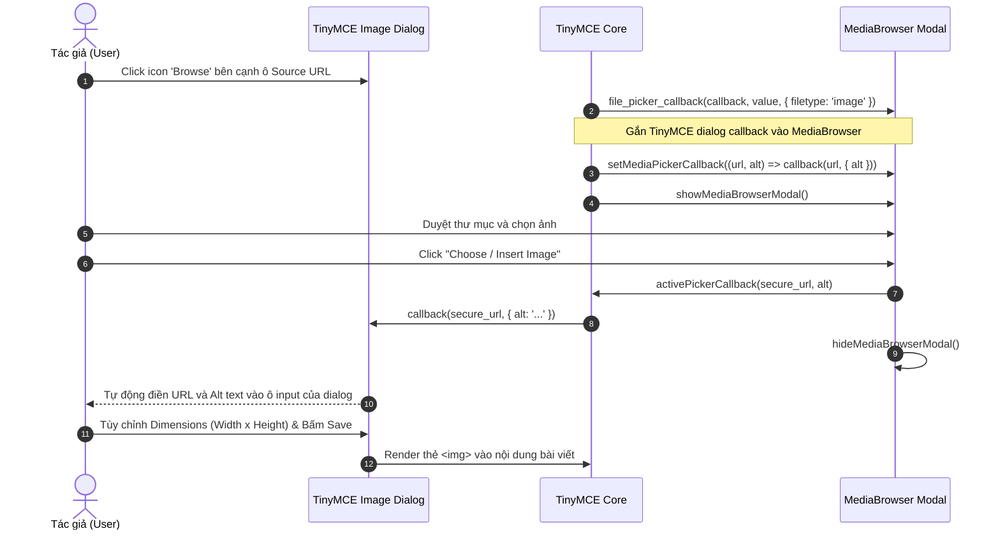
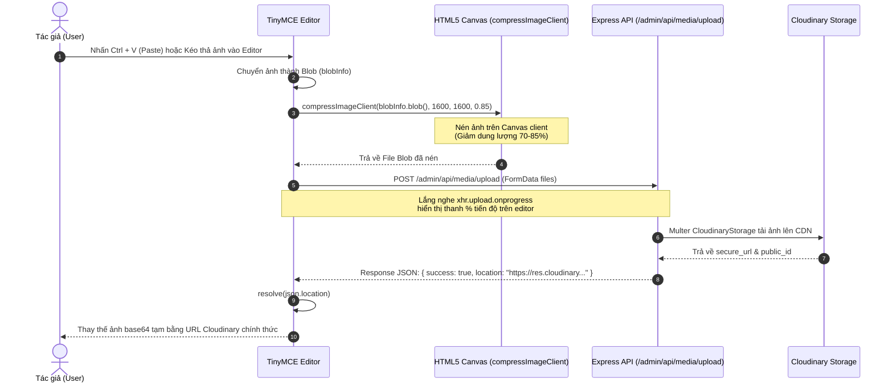
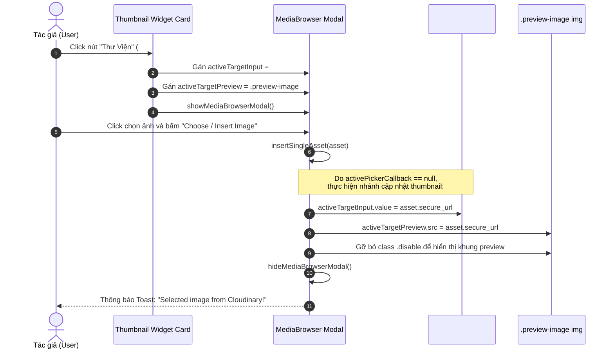

# Integration Flow – Luồng Tích Hợp & Sequence Diagrams

Tài liệu này là phần đặc tả quan trọng nhất về mặt cơ chế phối hợp (Orchestration & Contracts) giữa **Rich Text Editor (TinyMCE 6.3)** và **Media Library (MediaBrowser SPA)**.

---

## 1. Cơ Chế Kết Nối Callback Giữa Hai Module (The Callback Contract)

Hai module hoạt động theo kiến trúc Loose-Coupling (liên kết lỏng). Media Library không cần biết ai đang yêu cầu ảnh (nút trên thanh toolbar, dialog của TinyMCE hay nút chọn ảnh đại diện Thumbnail của form bài viết).

Sự kết nối này được điều phối thông qua các biến phạm vi module trong `public/js/admin/media-browser.js`:

```javascript
// Biến lưu trữ hàm callback đang hoạt động
let activePickerCallback = null;

// Biến lưu trữ input và khung preview mục tiêu (khi chọn ảnh đại diện)
let activeTargetInput = null;
let activeTargetPreview = null;

/**
 * Đăng ký hàm callback nhận dữ liệu khi người dùng chọn ảnh
 * @param {Function} callback (url, alt, asset) => void
 */
export function setMediaPickerCallback(callback) {
    activePickerCallback = callback;
}

/**
 * Mở hộp thoại Modal Media Library
 */
export const showMediaBrowserModal = () => {
    const modalEl = document.getElementById('cloudinaryMediaModal');
    if (!modalEl) return;
    
    // Sử dụng Tabler / Bootstrap 5 Modal instance
    const BootstrapModal = window.bootstrap?.Modal || window.tabler?.Modal;
    if (BootstrapModal) {
        const instance = BootstrapModal.getOrCreateInstance(modalEl);
        instance.show();
    }
    
    // Tự động làm mới và nạp danh sách ảnh mới nhất
    if (window._modalMediaBrowser) {
        window._modalMediaBrowser.refresh();
    }
};

/**
 * Đóng hộp thoại Modal Media Library
 */
export const hideMediaBrowserModal = () => {
    const modalEl = document.getElementById('cloudinaryMediaModal');
    if (!modalEl) return;
    const BootstrapModal = window.bootstrap?.Modal || window.tabler?.Modal;
    if (BootstrapModal) {
        const instance = BootstrapModal.getInstance(modalEl);
        if (instance) instance.hide();
    }
};
```

---

## 2. Sequence Diagram 1: Chọn Ảnh Qua Custom Toolbar Button (`cloudinary_media`)

Đây là luồng tương tác phổ biến nhất khi tác giả đang viết bài và muốn chèn một hoặc nhiều ảnh từ thư viện vào nội dung:

```mermaid
sequenceDiagram
    autonumber
    actor User as Tác giả (User)
    participant TME as TinyMCE Editor
    participant MB as MediaBrowser Modal
    participant API as Express API (/admin/api/media)
    participant Cloud as Cloudinary CDN

    User->>TME: Click nút icon 'cloudinary_media' trên Toolbar
    Note over TME,MB: Thiết lập callback chèn thẻ 
    TME->>MB: setMediaPickerCallback((url, alt) => { editor.insertContent(...) })
    TME->>MB: showMediaBrowserModal()
    MB->>API: GET /admin/api/media/assets?folder=Blog
    API->>Cloud: cloudinary.search.expression(...)
    Cloud-->>API: Trả về danh sách resources
    API-->>MB: Response JSON (assets list)
    MB->>User: Hiển thị giao diện duyệt ảnh (Grid, Folders)

    User->>MB: Click chọn ảnh (hoặc Double-click)
    User->>MB: Click "Choose / Insert Image"
    MB->>TME: Thực thi activePickerCallback(secure_url, filename, asset)
    Note over TME: Tạo đoạn mã HTML:<br/><p>style="max-width: 100%; height: auto;" loading="lazy" /></p>
    TME->>TME: editor.insertContent(imgHtml)
    MB->>MB: hideMediaBrowserModal()
    TME-->>User: Ảnh xuất hiện lập tức trong khung soạn thảo
```

---

## 3. Sequence Diagram 2: Chọn Ảnh Qua TinyMCE Image Dialog (`file_picker_callback`)

Luồng này xảy ra khi tác giả sử dụng dialog chèn ảnh chuẩn của TinyMCE để tùy biến thêm kích thước, viền, hoặc chú thích (caption):



---

## 4. Sequence Diagram 3: Kéo Thả / Paste Trực Tiếp Vào Editor (`images_upload_handler`)

Khi tác giả chụp ảnh màn hình và nhấn `Ctrl + V` hoặc kéo thẳng tệp ảnh từ máy tính thả vào khung soạn thảo:



---

## 5. Sequence Diagram 4: Lưu Bài Viết & Tải Lại Khi Chỉnh Sửa (Post Persistence Flow)

Mô tả cách thức chuỗi HTML từ TinyMCE được lưu vào MongoDB và tải lại nguyên vẹn khi tác giả mở trang Edit Post:

```mermaid
sequenceDiagram
    autonumber
    actor User as Tác giả (User)
    participant View as Form add-post / edit-post
    participant Val as form-validator.js
    participant Server as Express Controller (addPost / updatePost)
    participant DB as MongoDB (Collection: blog)

    User->>View: Bấm nút "Xuất Bản Bài Viết" (Submit Form)
    View->>Val: initAdminFormValidation() kích hoạt
    Val->>Val: tinymce.get('editor-content').getContent({ format: 'text' })
    Note over Val: Kiểm tra text thuần >= 10 ký tự
    Val-->>View: Hợp lệ -> Cho phép gửi request POST / PUT
    
    View->>Server: POST /admin/posts (req.body: { title, slug, thumbnail, content })
    Note over Server: Tính toán readingTime(content)<br/>Tạo slug duy nhất (generateUniqueSlug)
    Server->>DB: blogModel.create({ content: req.body.content, ... })
    DB-->>Server: Lưu thành công Document
    Server-->>User: Redirect về /admin/posts kèm Toast Success

    Note over User,DB: --- KHI MỞ TRANG CHỈNH SỬA BÀI VIẾT ---
    User->>Server: GET /admin/posts/:id/edit
    Server->>DB: blogModel.findById(id)
    DB-->>Server: Trả về post document
    Server->>View: Render edit-post.ejs ({ blogs: post })
    Note over View: Đặt chuỗi HTML vào textarea:<br/><textarea id="editor-content"><%= blogs.content %></textarea>
    View->>View: tinymce.init({ selector: "#editor-content" })
    Note over View: TinyMCE đọc nội dung có sẵn trong textarea<br/>và khôi phục đầy đủ cây DOM soạn thảo
    View-->>User: Hiển thị bài viết sẵn sàng chỉnh sửa
```



---

## 6. Sequence Diagram 5: Chọn Ảnh Đại Diện Thumbnail Cho Bài Viết

Luồng mở Media Library độc lập từ bên ngoài TinyMCE (nút Thumbnail Picker):



---

## 7. Tóm Tắt Các Điểm Neo Kỹ Thuật (Integration Hooks)

Khi triển khai trên bất kỳ framework nào ở dự án mới, các móc nối sau cần được đảm bảo:

1. **Trước khi Submit Form**: Luôn gọi `tinymce.triggerSave()` (nếu dùng form submit chuẩn) hoặc đọc `tinymce.get('id').getContent()` (nếu gửi Ajax / Fetch JSON).
2. **Khi khởi tạo Picker Callback**: Luôn làm sạch biến callback (`activePickerCallback = null`) sau khi thực thi để tránh gọi nhầm ở lần mở modal tiếp theo.
3. **Thứ tự nạp Script**:
   - `block-script.ejs` (TinyMCE CDN) phải được tải trước.
   - Thẻ `<textarea id="editor-content">` phải có mặt trong DOM.
   - Module `public/js/admin.js` thực thi `initTinyMCE()` và `initMediaBrowser()`.

