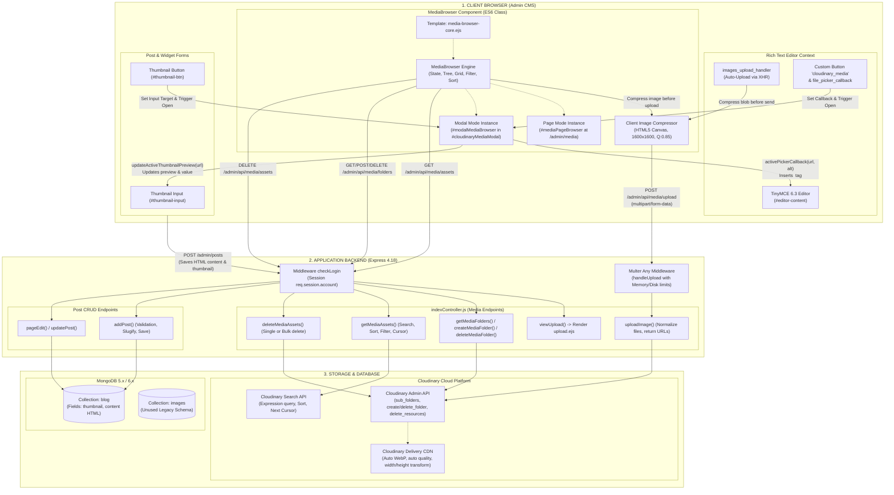

# Overview – Kiến Trúc Media Library & Rich Text Editor

Tài liệu này cung cấp cái nhìn tổng quan ở cấp độ kiến trúc hệ thống (System Architecture) về hai module trọng yếu trong hệ thống CMS: **Media Library (Thư viện Quản lý Đa phương tiện)** và **Rich Text Editor (Trình soạn thảo văn bản đa tính năng)**.

Mục tiêu của tài liệu là phân tích sâu, làm sáng tỏ toàn bộ cấu trúc mã nguồn hiện tại trong repository `Blog_Express_App`, tách bạch giữa logic nghiệp vụ thực tế và các thành phần di sản (legacy), từ đó tạo cơ sở độc lập để bất kỳ AI Coding Agent hoặc kỹ sư phát triển nào có thể tái tạo hoặc trích xuất sang dự án mới mà không cần quyền truy cập vào repository này.

---

## 1. Tóm Tắt Hiện Trạng & Khám Phá Kiến Trúc (Architectural Findings)

Qua việc kiểm tra và phân tích trực tiếp toàn bộ mã nguồn của `Blog_Express_App`, chúng tôi xác định hệ thống hiện có **hai phân hệ quản lý media song song** nhưng có vai trò và số phận khác nhau:

```
┌─────────────────────────────────────────────────────────────────────────────────┐
│                           CMS Admin Application Context                         │
├───────────────────────────────────────┬─────────────────────────────────────────┤
│    [PHÂN HỆ 1: DI SẢN (LEGACY / DEAD)] │  [PHÂN HỆ 2: CHỦ ĐẠO & ĐANG HOẠT ĐỘNG]  │
│                                       │                                         │
│ • FLMNGR File Manager Server Plugin   │ • Cloudinary Storage Engine             │
│   (@flmngr/flmngr-server-node-express)│   (Cloudinary SDK v2 + Multer)          │
│ • Endpoint: /flmngr                   │ • RESTful Media APIs (/admin/api/media) │
│ • Local storage: ./public/images      │ • Frontend SPA Component: MediaBrowser  │
│ • Trạng thái: Không được client gọi,   │ • UI Mode: Dual-Mode (Page & Modal)     │
│   không lưu ảnh Cloud, tàn dư cũ.     │ • Trạng thái: Hoạt động 100% sản xuất.  │
└───────────────────────────────────────┴─────────────────────────────────────────┘
```

1. **Phân hệ Di sản (Flmngr - Không khuyến nghị tái sử dụng)**:
   - Gói `@flmngr/flmngr-server-node-express` được gắn vào Express qua `bindFlmngr` ở `index.js` (đường dẫn `/flmngr`, lưu file cục bộ tại `./public/images`).
   - Trên thực tế, **không có bất kỳ mã JavaScript client nào** trong thư mục `public/js` tương tác hay mở giao diện FLMNGR.
   - Thư viện TinyMCE trên view được load qua đường link demo `https://flmngr.com/js-demo/tinymce-6.3/tinymce.min.js`, nhưng cấu hình toolbar và setup hoàn toàn bỏ qua plugin Flmngr để nối trực tiếp vào bộ **Cloudinary Media Browser tự phát triển**.
   - Biến `FLMNGR_KEY` và thuộc tính `data-key` trên textarea chỉ là tàn tích cấu hình chưa được dọn dẹp.

2. **Phân hệ Chủ đạo (Custom Cloudinary Media Browser + TinyMCE 6.3 - Khuyến nghị tái sử dụng)**:
   - **Frontend**: Một lớp điều khiển hướng đối tượng hoàn chỉnh `MediaBrowser` (`public/js/admin/media-browser.js`), có khả năng chạy ở 2 chế độ: Trang quản lý độc lập (`/admin/media`) và Modal chọn ảnh nhúng (`#cloudinaryMediaModal`).
   - **Tối ưu hóa Client-side**: Nén ảnh trực tiếp trên trình duyệt qua HTML5 Canvas trước khi gửi lên server (`compressImageClient` trong `public/js/admin/utils.js`).
   - **Backend Storage**: Module `utils/cloudinary.js` kết hợp `multer-storage-cloudinary` và Cloudinary Search API để cung cấp đầy đủ: Quản lý cây thư mục phân cấp, upload đa luồng, tìm kiếm nâng cao, lọc định dạng, sắp xếp, xóa đơn/xóa hàng loạt và phân trang con trỏ (cursor pagination).
   - **Tích hợp TinyMCE**: Tích hợp hai chiều qua custom button toolbar (`cloudinary_media`), chèn ảnh qua `file_picker_callback`, và tự động upload ảnh kéo thả / copy-paste qua `images_upload_handler`.

3. **Cơ chế Lưu trữ Dữ liệu (Database Persistence)**:
   - File `models/imagesModel.js` trong dự án thực tế là **orphan schema** (schema mồ côi, không hề được controller nào import hay ghi dữ liệu vào MongoDB).
   - Toàn bộ danh mục hình ảnh được truy vấn trực tiếp theo thời gian thực từ Cloudinary API.
   - MongoDB chỉ lưu URL ảnh cuối cùng: dưới dạng `thumbnail` (String) trong `blogModel` và nhúng trong chuỗi HTML `content` của bài viết.

---

## 2. Sơ Đồ Khối Kiến Trúc Tổng Thể (System Architecture Diagram)

Sơ đồ Mermaid dưới đây mô tả sự tương tác giữa Trình duyệt người dùng (Client Browser), Máy chủ ứng dụng (Express App), Cơ sở dữ liệu (MongoDB) và Dịch vụ Lưu trữ Đám mây (Cloudinary CDN):



---

## 3. Bản Đồ Thư Mục Mã Nguồn Liên Quan Trong Dự Án

Bảng dưới đây liệt kê chính xác các file mã nguồn liên quan đến Media Library và Rich Text Editor trong dự án gốc:

| Tầng chức năng | Đường dẫn tệp tin | Trách nhiệm chính |
| :--- | :--- | :--- |
| **Backend Storage Helper** | `utils/cloudinary.js` | Khởi tạo Cloudinary SDK v2, Multer CloudinaryStorage, các hàm wrapper `getMediaAssets`, `getSubFolders`, `createFolder`, `deleteFolder`, `deleteResources`. |
| **Backend Routes** | `routes/index.js` | Định nghĩa 8 endpoints RESTful: `/admin/media`, `/admin/api/media/*`, middleware `handleUpload`. |
| **Backend Controller** | `controllers/indexController.js` | Xử lý request/response cho toàn bộ API media (`viewUpload`, `getMediaFolders`, `getMediaAssets`, `uploadImage`, v.v.). |
| **Frontend Editor** | `public/js/admin/tinymce.js` | Cấu hình TinyMCE 6.3, tích hợp nút `cloudinary_media`, `file_picker_callback`, và `images_upload_handler`. |
| **Frontend Media SPA** | `public/js/admin/media-browser.js` | Class `MediaBrowser` (1027 dòng code), điều khiển cây thư mục, kéo thả, upload, inspector, chọn hàng loạt, callbacks. |
| **Frontend Modal Bridge** | `public/js/admin/media-modal.js` | Module chuyển tiếp và giữ tương thích ngược cho việc mở modal picker từ các nơi khác nhau. |
| **Frontend Utilities** | `public/js/admin/utils.js` | Hàm `compressImageClient` (HTML5 Canvas compression trước khi gửi qua mạng). |
| **Frontend Orchestrator**| `public/js/admin.js` | Entrypoint ES6 khởi tạo đồng thời form validator, TinyMCE, MediaBrowser và các module khác. |
| **View Template: Page** | `views/admin/pages/upload.ejs` | View hiển thị trang Media Library độc lập. |
| **View Template: Partial**| `views/admin/partials/media-browser-core.ejs`| Giao diện chính của MediaBrowser (Toolbar, Folder Sidebar, Grid, Inspector, Dropzone, Upload progress). |
| **View Template: Modal** | `views/admin/partials/cloudinary-modal.ejs` | Hộp thoại Bootstrap Modal bọc `media-browser-core.ejs` ở chế độ `isPicker = true`. |
| **View Template: Form** | `views/admin/pages/add-post.ejs`, `edit-post.ejs` | Form soạn thảo bài viết chứa `<textarea id="editor-content">` và nút chọn thumbnail `#thumbnail-btn`. |
| **Database Model** | `models/blogModel.js` | Lưu trữ kết quả cuối cùng: trường `thumbnail` và `content` HTML. |
| **Orphan Model** | `models/imagesModel.js` | Model mồ côi (không sử dụng trong luồng chạy thực tế). |

---

## 4. Cấu Trúc Bộ Tài Liệu Kỹ Thuật (`/docs/modules/media-editor/`)

Bộ tài liệu này được cấu trúc thành 9 phần chuyên sâu, độc lập và bổ trợ lẫn nhau:

```
docs/modules/media-editor/
├── overview.md                       # [Tài liệu hiện tại] Tổng quan kiến trúc & sơ đồ hệ thống
├── media-library.md                  # Đặc tả kỹ thuật chi tiết Frontend Media Library & UI/UX
├── richtext-editor.md                # Đặc tả Rich Text Editor (TinyMCE 6.3) & Tích hợp soạn thảo
├── cloudinary-integration.md         # Kiến trúc lưu trữ Cloudinary, Multer & Search API
├── integration-flow.md               # Luồng tích hợp giữa Editor & Media kèm 5 Sequence Diagrams
├── database-api-design.md            # Đặc tả API RESTful và lược đồ dữ liệu Database
├── dependencies-config.md            # Danh mục thư viện, phiên bản, CDN và cấu hình môi trường (.env)
├── reusability-assessment.md         # Đánh giá khả năng tái sử dụng (Reusable/Adaptable/Legacy)
└── new-project-implementation-guide.md # Hướng dẫn từng bước triển khai cho AI Agent ở dự án mới
```

---

## 5. Hướng Dẫn Dành Cho AI Coding Agent Ở Dự Án Mới

Nếu bạn là một AI Coding Agent đang nhận lệnh triển khai module này trên một codebase mới:

1. **Bỏ qua hoàn toàn FLMNGR**: Không cài đặt `@flmngr/flmngr-server-node-express` và không sử dụng endpoint `/flmngr`. Bạn sẽ sử dụng kiến trúc Cloudinary RESTful API trực tiếp.
2. **Không cần bảng `images` nếu lưu Cloud-native**: Nếu hệ thống mới dựa trên Cloudinary Search API, bạn không bắt buộc phải tạo bảng CSDL riêng để lưu danh mục ảnh. Tuy nhiên, nếu bạn muốn đổi sang AWS S3 hoặc MinIO (vốn không có Search API linh hoạt như Cloudinary), hãy xem tài liệu `database-api-design.md` để triển khai bảng `MediaAssets` cục bộ.
3. **Thứ tự đọc tài liệu được khuyến nghị**:
   - Bước 1: Đọc `overview.md` để nắm bối cảnh.
   - Bước 2: Đọc `integration-flow.md` để hiểu luồng tương tác giữa TinyMCE và Media Browser.
   - Bước 3: Đọc `database-api-design.md` và `cloudinary-integration.md` để dựng Backend API.
   - Bước 4: Đọc `media-library.md` và `richtext-editor.md` để dựng Frontend.
   - Bước 5: Làm theo checklist chi tiết tại `new-project-implementation-guide.md`.

