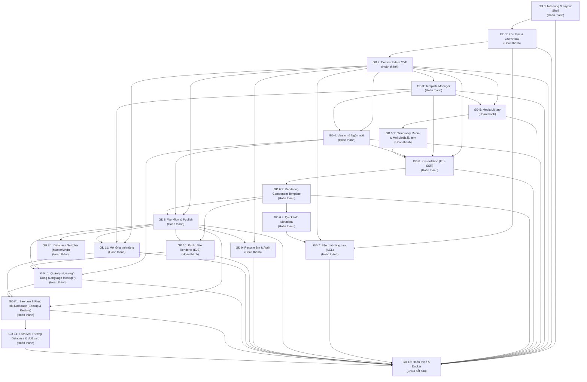

# Lộ trình & Bảng Tổng hợp Tiến độ (Project Phases Roadmap)
> File: `docs/phases/README.md`  
> Mô tả: Nguồn sự thật duy nhất (Single Source of Truth) về trạng thái thực thi và quan hệ phụ thuộc giữa 13 giai đoạn (GĐ 0 → GĐ 12).

---

## 1. Sơ đồ Phụ thuộc giữa các Giai đoạn (Phase Dependency Graph)

---

## 2. Bảng Tổng hợp Tiến độ 13 Giai đoạn (GĐ 0 → GĐ 12)

| GĐ | Tên giai đoạn | Trạng thái | Phụ thuộc | File chi tiết | Ngày bắt đầu | Ngày hoàn thành | Ghi chú |
| :---: | :--- | :--- :---: | :---: | :--- | :---: | :---: | :--- |
| **0** | Khởi tạo nền tảng & Layout Shell | **Hoàn thành** | - | [`phase-00-bootstrap.md`](./phase-00-bootstrap.md) | 2026-11-03 | 2026-11-03 | Xong express, layout ejs, css treecraft theme, smoke test |
| **1** | Nền tảng xác thực & Launchpad | **Hoàn thành** | 0 | [`phase-01-foundation.md`](./phase-01-foundation.md) | 2026-11-03 | 2026-11-03 | Xong User/Role, Session MongoStore, Login Treecraft, Launchpad role-based |
| **2** | Content Editor MVP (Cây, CRUD, Ribbon) | **Hoàn thành** | 1 | [`phase-02-content-editor-mvp.md`](./phase-02-content-editor-mvp.md) | 2026-11-03 | 2026-11-03 | Xong Item model, Fancytree lazy-load + dnd5, Partial Form, Ribbon Home |
| **3** | Template Manager (Fields, Kế thừa) | **Hoàn thành** | 2 | [`phase-03-template-manager.md`](./phase-03-template-manager.md) | 2026-11-03 | 2026-11-03 | Xong Template builder, Base Templates cycle detection, Standard Values, Insert Options |
| **4** | Quản lý Phiên bản & Đa ngôn ngữ | **Hoàn thành** | 2, 3 | [`phase-04-versions-languages.md`](./phase-04-versions-languages.md) | 2026-11-03 | 2026-11-03 | Xong Version/Language, 3 cấp trường, schema Presentation, Ribbon Versions, Diff compare |
| **5** | Media Library & Media Picker Modal | **Hoàn thành** | 2, 3 | [`phase-05-media-library.md`](./phase-05-media-library.md) | 2026-11-03 | 2026-11-03 | Cây thư mục media, sharp resize thumbnail, Media Picker modal, TinyMCE 6, Canvas compression, magic bytes |
| **5.1** | Tái định nghĩa Media Library (Cloudinary & Mọi Media là Item) | **Hoàn thành** | 5 | [`phase-05-1-cloudinary-media.md`](./phase-05-1-cloudinary-media.md) | 2026-11-05 | 2026-11-05 | Chuyển đổi toàn diện: Xóa bỏ collection `media`, chuyển mọi media thành Item dưới `/root/media library`, Cloudinary 1-1 mapping, Reverse Sync, CDN Transformation URL |
| **6** | Presentation (Layout, Rendering, Placeholders) | **Hoàn thành** | 2, 3, 4, 5 | [`phase-06-presentation.md`](./phase-06-presentation.md) | 2026-11-04 | 2026-11-04 | Quản trị Server-Side EJS Presentation: cây 3 nhánh (`Layouts`, `Placeholders`, `Renderings`), `viewPath`, SortableJS, Standard Presentation, `getFinalPresentation` |
| **6.2** | Rendering Component Template & Effective Fields | **Hoàn thành** | 6 | [`phase-06-2-rendering-template.md`](./phase-06-2-rendering-template.md) | 2026-11-04 | 2026-11-04 | Rendering gắn `componentTemplate`, Page Template không kế thừa qua `baseTemplates`, Content Editor tự suy ra trường bằng `resolveEffectiveTemplate` |
| **6.3** | Quick Info cho mọi Item trong Content Editor | **Hoàn thành** | 6.2 | [`phase-06-3-quick-info.md`](./phase-06-3-quick-info.md) | 2026-11-04 | 2026-11-04 | Section Quick Info chuẩn Treecraft: 6 dòng metadata, collapsible nhớ state, liên kết template, copy ID/path nhanh |
| **7** | Bảo mật nâng cao & Phân quyền ACL | **Hoàn thành** | 1, 2, 6.3 | [`phase-07-item-acl.md`](./phase-07-item-acl.md) | 2026-11-08 | 2026-11-08 | Phân quyền Item-level ACL, Access Viewer, Security Editor, Role/User Manager, DEC-042 |
| **8** | Workflow Engine, Workbox & Publishing | **Hoàn thành** | 2, 4, 6 | [`phase-08-workflow-publish.md`](./phase-08-workflow-publish.md) | 2026-11-07 | 2026-11-07 | Hoàn thành trước GĐ 7 theo DEC-039; trừu tượng hóa quyền qua `canPerform`; tách Master/Web, Workflow Engine, Workbox, Publishing Engine, Publish Manager |
| **8.1** | Bộ chuyển Database Master / Web trong Content Editor | **Hoàn thành** | 8 | [`phase-08-1-database-switcher.md`](./phase-08-1-database-switcher.md) | 2026-11-07 | 2026-11-07 | Chuyển đổi Master/Web qua `?db=web`, duyệt cây & form Web chỉ đọc, huy hiệu Publish status, trang đối soát `/admin/databases` |
| **9** | Thùng rác (Recycle Bin) & Audit Log | **Hoàn thành** | 2, 8 | [`phase-09-recycle-bin-audit.md`](./phase-09-recycle-bin-audit.md) | 2026-11-09 | 2026-11-09 | Xong cơ chế Safe Deletion (BLOCK/WARN), Recycle Bin khôi phục vị trí cũ, đồng bộ Web Store & Cloudinary, Audit Log bất đồng bộ via EventBus & script dọn dẹp hết hạn |
| **10** | Public Site Renderer & In-Memory Cache | **Hoàn thành** | 6, 8 | [`phase-10-delivery-layout-api.md`](./phase-10-delivery-layout-api.md) | 2026-11-07 | 2026-11-07 | Thực hiện trước GĐ 7 và GĐ 9 theo DEC-040; Public Site Router, URL Resolver, render layout/component EJS qua placeholder helper, error boundary, render cache |
| **R1** | Rebrand "Treecraft" & Đổi Root `/root` → `/root` | **Hoàn thành** | 0 → 8.1, 10 | [`phase-R1-rebrand-root-rename.md`](./phase-R1-rebrand-root-rename.md) | 2026-11-08 | 2026-11-08 | Đổi tên sản phẩm sang Treecraft, root node sang `/root`, hằng số hóa `branding.js`, migration path Master/Web, DEC-043 |
| **R2** | Hoàn tất đổi tên Treecraft / Root (Dọn sạch sót) | **Hoàn thành** | R1 | [`phase-R2-cleanup-treecraft.md`](./phase-R2-cleanup-treecraft.md) | 2026-11-08 | 2026-11-08 | Quét toàn diện 932 vị trí còn sót, chuẩn hóa 100% code, test, seed, EJS, docs sang Treecraft và `/root`, bổ sung `check:branding` |
| **B1** | Basic Auth (Bảo vệ Phân vùng Quản trị Admin CMS) | **Hoàn thành** | 0, 1 | [`phase-B1-basic-auth.md`](./phase-B1-basic-auth.md) | 2026-11-09 | 2026-11-09 | Bảo vệ phân vùng quản trị Admin CMS qua HTTP Basic Auth, phòng thủ 2 lớp (Defense-in-Depth), quản lý trong Control Panel, chống brute-force, gỡ khoá khẩn cấp |
| **11** | Serialization (JSON Export/Import 2 Tab & Toast) | **Hoàn thành** | 2, 3, 8 | [`phase-11-extensions.md`](./phase-11-extensions.md) | 2026-11-09 | 2026-11-09 | Trang quản trị Serialization 2 Tab (Export/Import), tùy chọn 5 phân vùng, thứ tự nạp an toàn 4 bước & thông báo Toast chi tiết |
| **L1** | Quản lý Ngôn ngữ Động (Language Manager) Thay thế Hard-code | **Hoàn thành** | 4, 4.1, 8, 10 | [`phase-L1-language-manager.md`](./phase-L1-language-manager.md) | 2026-11-09 | 2026-11-09 | Chuyển đổi ngôn ngữ thành Item (/root/system/Languages), languageService duy nhất, dynamic prefix & views, check:languages |
| **F1** | Universal Custom Field System - Nền Tảng Core | **Hoàn thành** | 2, 3, 4, 4.1 | [`phase-F1-custom-fields-core.md`](./phase-F1-custom-fields-core.md) | 2026-11-09 | 2026-11-09 | Field Registry, Universal Form Renderer, 8 trường gốc + 6 trường mở rộng, nâng cấp Template Schema |
| **F2** | Universal Custom Field System - Động Cơ Phức Hợp | **Hoàn thành** | F1, 2, 3, 4, 4.1 | [`phase-F2-complex-engines.md`](./phase-F2-complex-engines.md) | 2026-11-09 | 2026-11-09 | Repeater Engine kéo thả SortableJS, Field Group Layout, Conditional Visibility Engine reactive |
| **F3** | Universal Custom Field System - An Toàn & Hoàn Thiện Danh Mục | **Hoàn thành** | F1, F2, 2, 3, 7 | [`phase-F3-hardening-catalog.md`](./phase-F3-hardening-catalog.md) | 2026-11-09 | 2026-11-09 | Field-level ACL (read/write/hidden), hoàn thiện danh mục toàn diện 30+ Field Types (33 types đạt chuẩn) |
| **K1** | Sao Lưu & Phục Hồi Database (Backup & Restore) | **Hoàn thành** | 0, 1, 5.1, 7, 8, 8.1, 9, 10, 11 | [`phase-K1-backup-restore.md`](./phase-K1-backup-restore.md) | 2026-11-10 | 2026-11-10 | Dual-Engine mongodump/NDJSON, AES-256-GCM, SHA-256, Safe Restore 2 modes, Chế độ bảo trì 503, Retention & Scheduler, DEC-051 |
| **E1** | Tách Môi Trường Database (Local / Cloud) & dbGuard | **Hoàn thành** | 0, 1, 5.1, 7, 8, 8.1, 9, 10, 11, K1 | [`phase-E1-environments.md`](./phase-E1-environments.md) | 2026-11-10 | 2026-11-10 | Tách Mongo local Docker cho dev, cloud cho staging/prod, dbGuard chốt chặn an toàn, DB test tạm _tmp_*, DEC-052 |
| **12** | Hoàn thiện, Bảo mật, E2E SSR Test & Docker | **Chưa bắt đầu** | 0 → 11, L1, K1, E1 | [`phase-12-hardening.md`](./phase-12-hardening.md) | - | - | E2E test luồng Page -> Template -> Presentation -> Publish -> Site Renderer EJS |

---

## 3. Quy tắc Đồng bộ Trạng thái
- Khi một giai đoạn hoàn thành, trạng thái phải được cập nhật đồng thời ở:
  1. Bảng trên (`docs/phases/README.md`)
  2. Front-matter của file phase tương ứng (`status: Hoàn thành` trong `docs/phases/phase-nn-*.md`)
