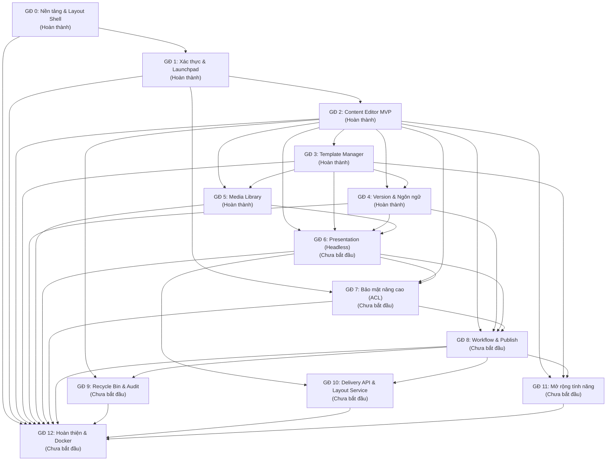

# Lộ trình & Bảng Tổng hợp Tiến độ (Project Phases Roadmap)
> File: `docs/phases/README.md`  
> Mô tả: Nguồn sự thật duy nhất (Single Source of Truth) về trạng thái thực thi và quan hệ phụ thuộc giữa 13 giai đoạn (GĐ 0 → GĐ 12).

---

## 1. Sơ đồ Phụ thuộc giữa các Giai đoạn (Phase Dependency Graph)

---

## 2. Bảng Tổng hợp Tiến độ 13 Giai đoạn (GĐ 0 → GĐ 12)

| GĐ | Tên giai đoạn | Trạng thái | Phụ thuộc | File chi tiết | Ngày bắt đầu | Ngày hoàn thành | Ghi chú |
| :---: | :--- | :---: | :---: | :--- | :---: | :---: | :--- |
| **0** | Khởi tạo nền tảng & Layout Shell | **Hoàn thành** | - | [`phase-00-bootstrap.md`](./phase-00-bootstrap.md) | 2026-11-03 | 2026-11-03 | Xong express, layout ejs, css sitecore theme, smoke test |
| **1** | Nền tảng xác thực & Launchpad | **Hoàn thành** | 0 | [`phase-01-foundation.md`](./phase-01-foundation.md) | 2026-11-03 | 2026-11-03 | Xong User/Role, Session MongoStore, Login Sitecore, Launchpad role-based |
| **2** | Content Editor MVP (Cây, CRUD, Ribbon) | **Hoàn thành** | 1 | [`phase-02-content-editor-mvp.md`](./phase-02-content-editor-mvp.md) | 2026-11-03 | 2026-11-03 | Xong Item model, Fancytree lazy-load + dnd5, Partial Form, Ribbon Home |
| **3** | Template Manager (Fields, Kế thừa) | **Hoàn thành** | 2 | [`phase-03-template-manager.md`](./phase-03-template-manager.md) | 2026-11-03 | 2026-11-03 | Xong Template builder, Base Templates cycle detection, Standard Values, Insert Options |
| **4** | Quản lý Phiên bản & Đa ngôn ngữ | **Hoàn thành** | 2, 3 | [`phase-04-versions-languages.md`](./phase-04-versions-languages.md) | 2026-11-03 | 2026-11-03 | Xong Version/Language, 3 cấp trường, schema Presentation, Ribbon Versions, Diff compare |
| **5** | Media Library & Media Picker Modal | **Hoàn thành** | 2, 3 | [`phase-05-media-library.md`](./phase-05-media-library.md) | 2026-11-03 | 2026-11-03 | Cây thư mục media, sharp resize thumbnail, Media Picker modal, TinyMCE 6, Canvas compression, magic bytes |
| **6** | Presentation (Layout, Rendering, Placeholders) | **Chưa bắt đầu** | 2, 3, 4, 5 | [`phase-06-presentation.md`](./phase-06-presentation.md) | - | - | Giai đoạn mới kiến trúc Headless: SortableJS, Standard Presentation, Delta Override |
| **7** | Bảo mật nâng cao & Phân quyền ACL | **Chưa bắt đầu** | 1, 2, 6 | [`phase-07-item-acl.md`](./phase-07-item-acl.md) | - | - | Đánh số lại từ GĐ 6 cũ; bổ sung phân quyền Presentation Details |
| **8** | Workflow Engine, Workbox & Publishing | **Chưa bắt đầu** | 2, 4, 6, 7 | [`phase-08-workflow-publish.md`](./phase-08-workflow-publish.md) | - | - | Đánh số lại từ GĐ 7 cũ; publish Item, Presentation và cảnh báo Datasource |
| **9** | Thùng rác (Recycle Bin) & Audit Log | **Chưa bắt đầu** | 2, 8 | [`phase-09-recycle-bin-audit.md`](./phase-09-recycle-bin-audit.md) | - | - | Đánh số lại từ GĐ 8 cũ; audit log biến động Presentation & kiểm tra toàn vẹn xoá |
| **10** | Headless Delivery API, Layout Service & Cache | **Chưa bắt đầu** | 6, 8 | [`phase-10-delivery-layout-api.md`](./phase-10-delivery-layout-api.md) | - | - | Đánh số lại từ GĐ 9 cũ; Headless Layout Service cho React frontend |
| **11** | Mở rộng tính năng (Forms, Serialization) | **Chưa bắt đầu** | 2, 3, 8 | [`phase-11-extensions.md`](./phase-11-extensions.md) | - | - | Đánh số lại từ GĐ 10 cũ; Forms Builder, Search, Experience Editor iframe (ưu tiên thấp) |
| **12** | Hoàn thiện, Bảo mật, Test & Docker | **Chưa bắt đầu** | 0 → 11 | [`phase-12-hardening.md`](./phase-12-hardening.md) | - | - | Đánh số lại từ GĐ 11 cũ; E2E test luồng Presentation -> Publish -> Layout Service |

---

## 3. Quy tắc Đồng bộ Trạng thái
- Khi một giai đoạn hoàn thành, trạng thái phải được cập nhật đồng thời ở:
  1. Bảng trên (`docs/phases/README.md`)
  2. Front-matter của file phase tương ứng (`status: Hoàn thành` trong `docs/phases/phase-nn-*.md`)

