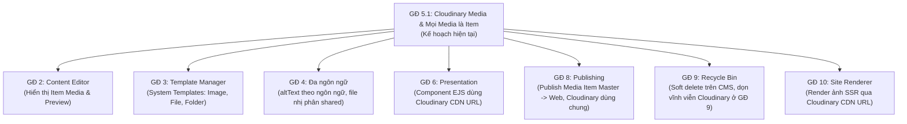
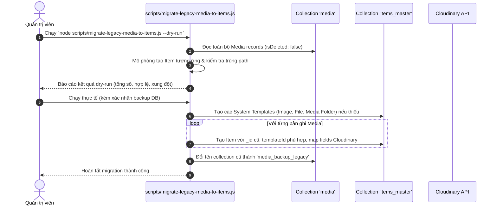

# Giai đoạn 5.1: Tái định nghĩa Thư viện Đa phương tiện — Cloudinary Storage & Mọi Media là Item (Media Library Redefinition)
> File: `docs/phases/phase-05-1-cloudinary-media.md`  
> Giai đoạn: **5.1**  
> Trạng thái: **Hoàn thành**  
> Phụ thuộc: **GĐ 5** (Kế thừa và điều chỉnh GĐ 5)  
> Ngày bắt đầu: 2026-11-05  
> Ngày hoàn thành: 2026-11-05  

---

## 1. Mục tiêu Giai đoạn
Tái cấu trúc toàn diện phân hệ Quản lý Đa phương tiện (Media Library) theo hai nguyên lý cốt lõi:
1. **Triết lý Sitecore XM thuần túy — "Mọi Media đều là Item"**:
   - Xóa bỏ mô hình CSDL phân mảnh (loại bỏ collection tách rời `media`).
   - Mọi tệp ảnh, tài liệu, video và thư mục media đều là các **Item** chính danh thuộc collection `items_master` (và xuất bản sang `items_web` ở GĐ 8) nằm dưới nhánh cây phân cấp `/sitecore/media library`.
   - Mỗi item media gắn với một **System Template** tương ứng (`Media Folder`, `Image`, `File`, `Video`) tại `/sitecore/templates/System`.
   - Tên của Item media **không chứa phần mở rộng file** (extension); phần mở rộng được lưu trữ tại trường dữ liệu `extension`.
2. **Cloudinary Cloud Storage là nguồn lưu trữ nhị phân duy nhất**:
   - Thư mục gốc `/AdminCMS` trên Cloudinary ánh xạ 1-1 với nhánh `/sitecore/media library` trên CMS. Cấu trúc cây thư mục con khớp nhau hoàn toàn.
   - Quản trị toàn bộ vòng đời tài nguyên nhị phân (Upload, Rename, Move, Replace, Delete) đồng bộ hai chiều thời gian thực giữa CMS Item Tree và Cloudinary.
   - Cung cấp công cụ Reverse Sync (`npm run media:sync` và UI Ribbon Sync) quét `/AdminCMS` trên Cloudinary để tự động nhập (import) asset sẵn có, cập nhật metadata và cảnh báo asset thất lạc.

---

## 2. Bảng Phân Tích Chuyển Đổi: Hiện Trạng → Yêu Cầu Mới → Hành Động → Rủi Ro

| Hạng mục | Hiện trạng (GĐ 5 cũ) | Yêu cầu mới (GĐ 5.1) | Hành động kỹ thuật | Rủi ro & Giải pháp giảm thiểu |
| :--- | :--- | :--- | :--- | :--- |
| **Vị trí lưu trữ dữ liệu** | Bảng CSDL riêng `media` (`collection: 'media'`) nằm tách rời với `items_master`. | Mọi media là Item nằm trong `items_master` dưới nhánh `/sitecore/media library`. | **Chuyển đổi dữ liệu (Migration):** Chuyển toàn bộ bản ghi từ `media` sang `Item` (`items_master`), gán template tương ứng, xóa bỏ collection `media`. | **Rủi ro:** Gãy ID tham chiếu trong các trường `Image` và thẻ Rich Text cũ. **Giải pháp:** Giữ nguyên chính xác `_id` cũ khi chuyển sang collection `items_master`. |
| **Tầng Storage Provider** | `LocalStorageProvider` lưu file cục bộ trên ổ cứng đĩa tại `storage/uploads/YYYY/MM/`. | `CloudinaryStorageProvider` lưu trữ độc quyền trên Cloudinary dưới thư mục gốc `AdminCMS`. | **Xóa / Sửa:** Xóa vĩnh viễn `LocalStorageProvider.js`. Chuẩn hóa `CloudinaryStorageProvider` theo interface `StorageProvider`. | **Rủi ro:** Lỗi mạng hoặc giới hạn API Cloudinary làm hỏng thao tác. **Giải pháp:** Bọc Transaction/Rollback an toàn; nếu Cloudinary lỗi thì không tạo/sửa Item; đánh dấu `syncStatus=error`. |
| **Cấu trúc Thư mục Cloudinary** | Tạo thư mục con theo thời gian `AdminCMS/YYYY/MM/`. | Khớp 1-1 với cây thư mục CMS: `AdminCMS/<đường dẫn item dưới media library>/`. | **Sửa:** Xóa bỏ `getDateSubdir()`; xây dựng hàm hai chiều `mediaPathMapper` ánh xạ giữa item path và Cloudinary `public_id`/`asset_folder`. | **Rủi ro:** Tên thư mục hoặc file có dấu tiếng Việt/ký tự đặc biệt gây lỗi URL Cloudinary. **Giải pháp:** Kebab-case chuẩn hóa cho Item name; mã hóa an toàn ký tự cho Cloudinary publicId. |
| **Định danh & Tên Item** | Tên item gắn kèm đuôi file: `hero-banner.jpg`. | Tên item không kèm đuôi file: `hero-banner`; đuôi file lưu ở field `extension`. | **Sửa:** Khi upload hoặc đồng bộ, tách `baseName` làm `item.name`, lưu đuôi file vào field `extension` và `format`. | **Rủi ro:** Hai file khác đuôi cùng tên (`banner.jpg` và `banner.png`) trong một thư mục bị xung đột tên item. **Giải pháp:** Chặn upload trùng tên, hiển thị thông báo lỗi rõ ràng hoặc yêu cầu đổi tên. |
| **System Templates cho Media** | Chưa có System Template chuẩn cho media trong Content Editor. | Tạo 3 System Templates tại `/sitecore/templates/System`: `Media Folder`, `Image`, `File` (kèm `Video`). | **Thêm mới (Seed):** Khởi tạo Template với đầy đủ Section và Fields (`publicId`, `secureUrl`, `dimensions`, `fileSize`, `altText`, `title`, `description`...). | **Rủi ro:** Template thiếu trường hoặc không tương thích hệ thống phân cấp. **Giải pháp:** Tuân thủ chuẩn Sitecore System Template schema đã định hình ở GĐ 3. |
| **Giao diện Item Form (Content Editor)** | Chưa có form biên tập chi tiết cho Item media trong Content Editor (chỉ có popup Inspector của MediaBrowser). | Content Editor hiển thị form biên tập Item Media hoàn chỉnh: Khung xem trước ảnh (preview), URL Cloudinary, kích thước, dung lượng, nút Download/Replace. | **Sửa / Thêm mới:** Tùy biến renderer cho trường media preview chỉ đọc trong Content Editor `item-form.ejs`. | **Rủi ro:** UI bị vỡ trên màn hình nhỏ hoặc load ảnh gốc quá nặng. **Giải pháp:** Sử dụng Cloudinary thumbnail transformation URL tối ưu hóa hiển thị. |
| **Sinh Thumbnail & Biến đổi ảnh** | Sử dụng thư viện `sharp` trên máy chủ Node.js để sinh file ảnh WebP lưu tại `storage/thumbnails/`. | Sử dụng trực tiếp **Cloudinary Transformation URL** theo các preset kích thước whitelisted (`thumb`, `medium`, `large`). | **Sửa:** Chuyển `generateThumbnail` sang Cloudinary URL builder với preset (`c_fill,h_300,w_300,f_webp,q_auto`). | **Rủi ro:** Lạm dụng query tùy tiện làm tăng phí bandwidth Cloudinary. **Giải pháp:** Giới hạn strict whitelist các preset tham số, không cho phép client truyền kích thước tự do. |
| **Phục vụ tệp tin cũ (`/media/file/:id`)** | Stream trực tiếp luồng nhị phân từ ổ cứng local. | Tự động chuyển hướng **HTTP 301/302 Redirect** sang Cloudinary CDN `secure_url`. | **Sửa:** Cập nhật endpoint `serveFile` trong `mediaController.js` chỉ thực hiện 302 Redirect sang CDN. | **Rủi ro:** Client không nhận diện 302 hoặc cache cũ. **Giải pháp:** Gửi kèm header `Cache-Control: public, max-age=31536000, immutable`. |
| **Đồng bộ ngược (Reverse Sync)** | Không hỗ trợ; phụ thuộc hoàn toàn vào file nội bộ trên máy chủ. | Hỗ trợ CLI `npm run media:sync` và nút "Sync from Cloudinary" trên Ribbon của Media Library. | **Thêm mới:** Xây dựng dịch vụ `mediaSyncService.js` phân trang duyệt Cloudinary Admin API, tạo item thiếu, cập nhật metadata, báo cáo asset mất. | **Rủi ro:** Rate-limit của Cloudinary Admin API (500 req/giờ). **Giải pháp:** Phân trang tối đa `max_results=500`, ghi log tiến độ, cờ `--dry-run`, cơ chế dừng an toàn khi gặp 429. |
| **Trình soạn thảo Rich Text & Field Image** | Lưu `mediaId` của collection `media`, resolve ra link `/media/file/:id`. | Lưu `mediaId` (trỏ đến `Item` trong `items_master`), hàm `resolveRichText` thay thế ra Cloudinary CDN URL trực tiếp. | **Sửa:** Cập nhật `src/utils/richTextHelper.js` và `public/js/admin/content-editor.js` để đọc trực tiếp Cloudinary URL từ Item fields. | **Rủi ro:** Trình duyệt tải chậm nếu link CDN không tối ưu. **Giải pháp:** Cho phép cấu hình kèm transformation tự động responsive (f_auto, q_auto). |

---

## 3. Bản Đồ Ảnh Hưởng & Điều Chỉnh Các Giai Đoạn Liên Quan

1. **GĐ 2 (Content Editor):**
   - Cây Fancytree hiển thị các Item media bên dưới `/sitecore/media library` tương tự các item nội dung khác, với icon phân biệt (ảnh, file, folder).
   - Form biên tập hiển thị section chuyên biệt: Preview ảnh, thông số kỹ thuật (publicId, kích thước, định dạng, dung lượng), nút Download và nút Replace.
2. **GĐ 3 (Template Manager):**
   - Đăng ký các System Templates trong nhánh `/sitecore/templates/System`:
     - `Media Folder` (chứa các item con, quản lý phân cấp).
     - `Image` (chứa các trường metadata ảnh: `publicId`, `assetId`, `format`, `extension`, `secureUrl`, `fileSize`, `width`, `height`, `checksum`, `altText`, `title`, `description`, `syncedAt`).
     - `File` (chứa metadata tài liệu/tệp chung: PDF, Zip, Docs).
     - `Video` (dành cho MP4/WebM nếu có).
3. **GĐ 4 (Version & Đa ngôn ngữ):**
   - Các trường nhị phân vật lý (`publicId`, `secureUrl`, `fileSize`, `width`, `height`, `extension`) là trường dùng chung (**Shared Fields**).
   - Các trường mô tả nội dung (`altText`, `title`, `description`) là trường đa ngôn ngữ (**Language-specific / Unversioned** hoặc **Versioned**) cho phép biên tập alt text tiếng Việt và tiếng Anh độc lập.
4. **GĐ 6 & GĐ 6.2 (Presentation Details & Rendering Components):**
   - Renderings có trường `Image` (ví dụ `HeroBanner`, `ImageText`) nhận giá trị là `mediaId` (Item ID), suy ra Cloudinary CDN URL và hiển thị trên EJS SSR view.
5. **GĐ 8 (Publishing - Kế hoạch tài liệu):**
   - Khi publish Item media: Xuất bản từ `items_master` sang `items_web`.
   - File nhị phân trên Cloudinary dùng chung giữa Master và Web (không nhân bản file trên Cloudinary để tối ưu chi phí lưu trữ).
6. **GĐ 9 (Recycle Bin & Dọn dẹp - Kế hoạch tài liệu):**
   - Khi xóa media trên CMS: Thực hiện Soft-delete (`isDeleted: true`), giữ nguyên file vật lý trên Cloudinary.
   - Khi dọn sạch thùng rác vĩnh viễn (Purge Recycle Bin ở GĐ 9): Mới kích hoạt lệnh hủy asset thực tế trên Cloudinary (`cloudinary.uploader.destroy`).

---

## 4. Đặc Tả Kỹ Thuật Chi Tiết

### 4.1. Hàm Ánh Xạ Đường Dẫn Hai Chiều (`mediaPathMapper`)
Module `src/utils/mediaPathMapper.js` chịu trách nhiệm chuẩn hóa duy nhất quy tắc chuyển đổi:
- **Từ CMS Item Path sang Cloudinary `public_id` và `asset_folder`:**
  - Nhánh gốc: `/sitecore/media library` tương ứng gốc `AdminCMS`.
  - Item Path: `/sitecore/media library/Banners/Summer/hero-banner`
  - `asset_folder`: `AdminCMS/Banners/Summer`
  - `public_id`: `AdminCMS/Banners/Summer/hero-banner` (đối với image/video, không kèm extension; đối với raw/file tài liệu, kèm extension).
- **Từ Cloudinary Asset sang CMS Item Path:**
  - Cloudinary asset: `asset_folder = 'AdminCMS/Banners/Summer'`, `display_name = 'hero-banner'` (hoặc cắt từ `public_id`).
  - Item Path: `/sitecore/media library/Banners/Summer/hero-banner`.
  - Item Name: `hero-banner` (kebab-case, không đuôi).

### 4.2. Xử Lý Trùng Tên (Name Conflict Policy)
- Quy tắc: Trong cùng một thư mục cha, không cho phép tồn tại hai item có cùng tên kỹ thuật `name`.
- Nếu tải lên tệp `hero-banner.png` khi đã có `hero-banner.jpg`: Hệ thống **chặn upload và thông báo lỗi rõ ràng** ("Item với tên 'hero-banner' đã tồn tại trong thư mục này. Vui lòng đổi tên trước khi tải lên.").

### 4.3. Chế Độ Thư Mục Cloudinary (Folder Mode)
- Qua kiểm tra thực tế tài khoản người dùng (`v41qu0lg`), hệ thống Cloudinary đang bật **Dynamic Folder Mode** (trả về cả `asset_folder` và `display_name`).
- Lớp `CloudinaryStorageProvider` sẽ gửi đồng thời:
  - `folder`: đường dẫn thư mục `AdminCMS/<subpath>`.
  - `public_id`: tên chuẩn hóa của item không kèm đuôi.
  - `use_filename: false`, `unique_filename: false`, `overwrite: false` (trừ khi là replace).

### 4.4. Cơ Chế Reverse Sync (`npm run media:sync`)
- Lệnh: `npm run media:sync [--dry-run] [--folder=AdminCMS/...]`
- Luồng hoạt động:
  1. Kết nối Cloudinary Admin API, duyệt phân trang danh sách asset dưới thư mục `AdminCMS` (`cloudinary.api.resources`).
  2. Với mỗi asset:
     - Dùng `mediaPathMapper` phân giải ra `targetItemPath`.
     - Tạo đệ quy các thư mục `Media Folder` nếu chưa tồn tại trên cây CMS.
     - Kiểm tra nếu Item chưa tồn tại: Tạo mới `Item` với template `Image` hoặc `File`, nạp đầy đủ metadata từ Cloudinary.
     - Nếu Item đã tồn tại: Cập nhật metadata thay đổi (dimensions, size, secureUrl, syncedAt).
  3. Báo cáo:
     - Số lượng asset tạo mới.
     - Số lượng asset cập nhật.
     - Danh sách asset trên CMS bị mất file trên Cloudinary (đánh dấu `missingOnCloudinary = true`, tuyệt đối không tự xóa Item).

---

## 5. Checklist Công Việc Chi Tiết (Bước 2)

### Task 5.1.1: Cấu hình Môi trường & Dependencies
- [x] Cập nhật `.env.example` với các biến chuẩn: `STORAGE_PROVIDER=cloudinary`, `CLOUDINARY_CLOUD_NAME`, `CLOUDINARY_API_KEY`, `CLOUDINARY_API_SECRET`, `CLOUDINARY_ROOT_FOLDER=AdminCMS`.
- [x] Thêm validation nghiêm ngặt trong `src/config/env.js` khi `STORAGE_PROVIDER=cloudinary` (thiếu credentials thì báo lỗi rõ ràng khi khởi động).
- [x] Kiểm tra package `cloudinary` (đã có trong dependencies); bảo đảm API Secret không bao giờ gửi ra trình duyệt; gỡ bỏ dependency `sharp` không còn sử dụng.

### Task 5.1.2: System Templates & Cấu trúc Item Media
- [x] Xây dựng migration/seed tạo 3 System Templates tại `/sitecore/templates/System`:
  - [x] `Media Folder`: icon `ti ti-folder`, insertOptions cho phép tạo `Media Folder`, `Image`, `File`.
  - [x] `Image`: icon `ti ti-photo`, các trường `publicId`, `assetId`, `format`, `extension`, `secureUrl`, `fileSize`, `width`, `height`, `checksum`, `altText` (đa ngôn ngữ), `title`, `description`.
  - [x] `File`: icon `ti ti-file`, các trường tương ứng cho tài liệu chung.
- [x] Đảm bảo node gốc `/sitecore/media library` là một `Item` chính danh sử dụng template `Media Folder`.

### Task 5.1.3: Module Ánh Xạ Đường Dẫn (`mediaPathMapper`)
- [x] Tạo `src/utils/mediaPathMapper.js` hỗ trợ chuyển đổi hai chiều:
  - [x] `itemPathToCloudinary({ itemPath, isRaw })`
  - [x] `cloudinaryToItemPath({ publicId, assetFolder, format, resourceType })`
  - [x] Xử lý ký tự an toàn, không dấu, kebab-case, không kèm đuôi file trong `item.name`.
- [x] Viết unit test độc lập cho `mediaPathMapper.test.js` bao quát mọi trường hợp: có dấu tiếng Việt, ký tự đặc biệt, lồng nhiều cấp, raw file.

### Task 5.1.4: Tầng Lưu Trữ & Phục Vụ File (`CloudinaryStorageProvider`)
- [x] Tinh chỉnh [`CloudinaryStorageProvider.js`](file:///Users/wainiidev/Downloads/Projects/Backend/Admin-CMS/src/services/storage/CloudinaryStorageProvider.js):
  - [x] Upload stream trực tiếp qua Multer memory buffer, không đọc toàn bộ file vào RAM.
  - [x] Quét Magic Bytes nhị phân (`fileSniffer.js`), khử độc SVG (`sanitize-html`) trước khi upload.
  - [x] Sinh transformation URL theo whitelist preset (`thumb`: 300x300 c_fill, `medium`: 800x600 c_fit, `large`: 1600x1200 c_fit).
  - [x] Đổi tên asset (`cloudinary.uploader.rename`) khi Item đổi tên.
  - [x] Di chuyển asset khi Item chuyển thư mục.
  - [x] Thay thế asset (`overwrite: true` kèm CDN cache invalidation).
- [x] Cập nhật endpoint `serveFile` (`GET /media/file/:id`): Redirect 302 trực tiếp sang Cloudinary CDN `secure_url`.

### Task 5.1.5: Nghiệp Vụ Đồng Bộ Hai Chiều (`mediaItemService`)
- [x] Hợp nhất nghiệp vụ Media vào mô hình `Item`:
  - [x] Tạo Item media dưới `/sitecore/media library` khi upload.
  - [x] Chặn trùng tên trong cùng thư mục.
  - [x] Cập nhật Cloudinary tương ứng khi Rename, Move, Replace.
  - [x] Xử lý lỗi Cloudinary: Rollback tạo Item nếu upload thất bại, không để lại dữ liệu rác.
  - [x] Xóa Item: Chỉ soft-delete trên CMS (`isDeleted: true`), không xóa file trên Cloudinary.
- [x] Xây dựng công cụ Reverse Sync:
  - [x] Service `src/services/mediaSyncService.js` hỗ trợ duyệt Cloudinary API có phân trang và rate-limit guard.
  - [x] CLI script `scripts/sync-cloudinary-media.js` tích hợp lệnh `npm run media:sync`.
  - [x] Nút "Sync from Cloudinary" trên Ribbon của Media Library dành cho Administrator.

### Task 5.1.6: Giao Diện Content Editor & MediaPicker
- [x] Cập nhật form biên tập item trong Content Editor:
  - [x] Nếu Item thuộc template `Image` hoặc `File`: Render section xem trước ảnh (preview), hiển thị thông số kỹ thuật (URL, dimensions, size), nút Download, nút Replace.
  - [x] Cho phép biên tập các trường metadata `altText` theo từng ngôn ngữ.
- [x] Cập nhật `MediaPicker` modal và field `Image`:
  - [x] Picker duyệt trực tiếp cây Item bên dưới `/sitecore/media library`.
  - [x] Lưu trữ `mediaId` (ID của Item media).
  - [x] Hiển thị thumbnail từ Cloudinary URL của Item.

### Task 5.1.7: Tích Hợp Rich Text Editor & Site Renderer
- [x] Cập nhật `src/utils/richTextHelper.js`:
  - [x] Thẻ `` chèn thuộc tính `data-media-id=":itemId"`.
  - [x] Hàm `resolveRichText` tìm Item trong `items_master`, thay thế `src` bằng Cloudinary `secure_url` (hỗ trợ preset kích thước).
- [x] Kiểm tra tính toàn vẹn khi render EJS SSR trên Website công khai.

### Task 5.1.8: Kế Hoạch Migration Dữ Liệu Cũ
- [x] Tạo script migration `scripts/migrate-legacy-media-to-items.js`:
  - [x] Đọc tất cả bản ghi từ collection `media`.
  - [x] Tạo các node `Item` tương ứng dưới `/sitecore/media library` với template chuẩn.
  - [x] Giữ nguyên chính xác `_id` của bản ghi cũ để không gãy liên kết trong các trường `Image` và bài viết Rich Text.
  - [x] Hỗ trợ cờ `--dry-run` và cờ `--rollback`.
  - [x] Nhắc nhở người dùng backup CSDL trước khi chạy.

### Task 5.1.9: Kiểm Thử Toàn Diện & Hồi Quy (Test Suite)
- [x] Viết bộ mock Cloudinary SDK hoàn chỉnh cho Jest (không gọi mạng thật).
- [x] Kiểm thử luồng upload, rename, move, replace, delete, sync, magic bytes sniffing, SVG sanitization.
- [x] Kiểm thử hồi quy toàn bộ 22 test suites từ GĐ 0 đến GĐ 6.2 (đảm bảo 100% test pass).
- [x] Kiểm tra ESLint đạt 0 lỗi, 0 cảnh báo.

---

## 6. Kế Hoạch Migration Dữ Liệu Chi Tiết

---

## 7. Definition of Done (DoD) & Tiêu Chí Nghiệm Thu

1. [ ] **Mọi Media là Item:** Nhánh `/sitecore/media library` chỉ chứa các `Item` thuộc collection `items_master`. Collection `media` cũ không còn được sử dụng ở luồng chính.
2. [ ] **Ánh xạ 1-1 với Cloudinary:** Mọi tệp tải lên đều được lưu tại `AdminCMS/<path>` trên Cloudinary. Item name trên CMS không chứa đuôi file.
3. [ ] **Đầy đủ System Templates:** Các template `Media Folder`, `Image`, `File` hoạt động ổn định tại `/sitecore/templates/System`.
4. [ ] **Giao diện Item Media:** Form biên tập Content Editor hiển thị preview ảnh từ Cloudinary, thông tin kỹ thuật chỉ đọc, cho phép sửa `altText` đa ngôn ngữ và có nút Replace/Download.
5. [ ] **Đồng bộ thao tác:** Thao tác Rename, Move, Replace trên CMS đồng bộ chính xác tới Cloudinary. Nếu Cloudinary gặp sự cố, hệ thống hủy thao tác và không tạo dữ liệu hỏng.
6. [ ] **Reverse Sync:** Lệnh `npm run media:sync` và UI Ribbon Sync quét thành công `/AdminCMS` trên Cloudinary, nhập asset còn thiếu, cập nhật metadata và báo cáo asset mất mà không nhân bản trùng lặp (Idempotent).
7. [ ] **Tương thích ngược:** MediaPicker, trường `Image`, trình soạn thảo TinyMCE và Site Renderer SSR hiển thị mượt mà với Cloudinary CDN URLs. Route `/media/file/:id` redirect 302 an toàn.
8. [ ] **Bảo mật tuyệt đối:** API Secret chỉ nằm ở server, không lộ ra client; file tải lên được quét Magic Bytes và khử độc SVG.
9. [ ] **Kiểm thử tự động:** `npm test` vượt qua 100% các bài test (bao gồm mock Cloudinary và toàn bộ test hồi quy từ GĐ 0 đến GĐ 6); `npm run lint` đạt 0 lỗi, 0 cảnh báo.
10. [ ] **Tài liệu hoàn chỉnh:** Báo cáo nghiệm thu `docs/reports/phase-05-1-report.md` được tạo, bảng tiến độ và các tài liệu liên quan được cập nhật đồng bộ.

