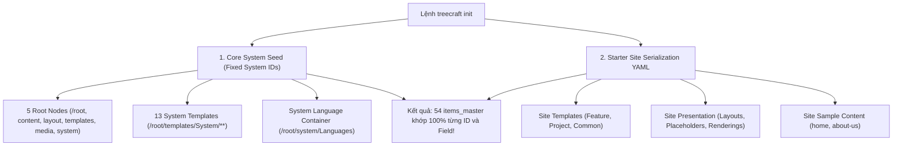

# BÁO CÁO KIỂM TOÁN CÂY NỘI DUNG (CONTENT TREE AUDIT) — GIAI ĐOẠN S

> **Mã tài liệu:** `docs/reports/S-tree-audit.md`  
> **Ngày kiểm toán:** 17/11/2026  
> **Nguồn dữ liệu:** MongoDB `items_master` (54 items), `items_web` (53 items), thư mục `Serialization/` (26 tệp YAML).

---

## 1. TỔNG QUAN HIỆN TRẠNG DATABASE

Qua truy vấn trực tiếp vào database hiện tại của hệ thống (`admin_cms`):
- **Bộ sưu tập `items_master`:** 54 items.
- **Bộ sưu tập `items_web`:** 53 items (đã đồng bộ gần như tuyệt đối, chỉ trừ 1 node chưa publish).
- **Phân bổ theo nhánh:**
  - `/root`: 1 node gốc.
  - `/root/content`: 3 items (`content`, `home`, `about-us`).
  - `/root/layout`: 12 items (`layout`, `Layouts`, `HomeLayout`, `Placeholders`, `header`, `footer`, `maincontent`, `Renderings`, `HeroBanner`, `ImageText`, `Introduction`, `carousel`).
  - `/root/media library`: 8 items (thư mục gốc + các file media mẫu).
  - `/root/system`: 2 items (`system`, `Languages`).
  - `/root/templates`: 28 items (gồm root `templates`, 13 System templates, 2 Common, 8 Feature, 4 Project).

---

## 2. ĐỐI SOÁT VỚI THƯ MỤC SERIALIZATION HIỆN TẠI

Thư mục `Serialization/` hiện lưu trữ **26 tệp YAML** chia theo 4 section:
1. `Layouts/`: 2 items (`Layouts`, `HomeLayout`).
2. `Placeholders/`: 4 items (`Placeholders`, `header`, `footer`, `maincontent`).
3. `Renderings/`: 5 items (`Renderings`, `HeroBanner`, `ImageText`, `Introduction`, `carousel`).
4. `Templates/`: 15 items (`templates`, `common`, `Folder`, `Feature`, `Components`, `carousel-item`, `dining-listing-page`, `HeroBanner`, `ImageText`, `Introduction`, `offer-item`, `Project`, `Pages`, `Home`, `about-us-page-template`).

### Danh sách 28 items có trong DB nhưng chưa có trong Serialization:
1. **5 Node gốc phân cấp hệ thống:**
   - `/root` (id: `6ae95cc6b1e541e051fd4162`)
   - `/root/content` (id: `6ae95cc6b1e541e051fd4165`)
   - `/root/layout` (id: `6aea24d7fb85fae7f0a409a8`)
   - `/root/media library` (id: `6ae95cc6b1e541e051fd4168`)
   - `/root/system` (id: `6ae95cc6b1e541e051fd416e`)
2. **13 System Templates (`/root/templates/System/**`):**
   - `System`, `Layout`, `Layout Folder`, `Page`, `Placeholder`, `Placeholder Folder`, `Rendering`, `Rendering Folder`, `Sample Item`, `Standard Template`, `Template`, `Template Folder`, `_BasePage`.
   - *Lý do:* Theo cấu hình `src/config/serializationSections.js`, System Templates mặc định bị loại trừ (`excludeRoots`) để tránh ghi đè logic lõi của CMS.
3. **2 Content Pages:**
   - `/root/content/home` (id: `6aeaf42fe620d879bafc2373`)
   - `/root/content/about-us` (id: `6aeb34f210a6df2700e096ed`)
   - *Lý do:* Section `Contents` chưa được reserialize vào `Serialization/Contents/`.
4. **7 Media Items:**
   - Các media mẫu và thư mục con dưới `/root/media library/`.
5. **1 System Language Container:**
   - `/root/system/Languages` (id: `6af17b670ffbbe032133f2b8`).

---

## 3. PHÂN ĐỊNH NGUỒN DỮ LIỆU ĐỂ ĐẠT 100% PARITY

Để khi chạy lệnh `init` trên một dự án mới hoàn toàn, cây nội dung `items_master` đạt **100% đồng nhất (Parity 100%)** với Core, hệ thống phân định rõ:

### Bảng phân loại nguồn cấp:
| Nhóm Item | Số lượng | Nguồn cấp chuẩn | Cơ chế bảo toàn ID |
| :--- | :--- | :--- | :--- |
| **System Skeleton & Roots** | 6 items | `core/src/scripts/seed-initial-data.js` | Dùng ID cố định bất biến (deterministic ObjectId) |
| **System Templates** | 13 items | `core/src/scripts/seed-initial-data.js` | Dùng ID cố định bất biến |
| **System Languages** | 1 item | `core/src/scripts/seed-initial-data.js` | Dùng ID cố định bất biến |
| **Component Templates** | 12 items | `core/starter/corporate/serialization/Templates` | Khôi phục nguyên vẹn `_id` từ tệp YAML |
| **Presentation Items** | 11 items | `core/starter/corporate/serialization/Layouts, Renderings, Placeholders` | Khôi phục nguyên vẹn `_id` từ tệp YAML |
| **Sample Pages** | 2 items | `core/starter/corporate/serialization/Contents` | Khôi phục nguyên vẹn `_id` từ tệp YAML |
| **Sample Media** | Media files | Media migration / Starter storage | Giữ ID nguyên vẹn |

---

## 4. CÔNG CỤ XÁC MINH VÀ BẢO BÌNH (PARITY TOOLS)

Hai công cụ mới sẽ được bổ sung trong GĐ S:
1. `npm run tree:snapshot`:
   - Trích xuất toàn bộ trạng thái của `items_master` thành tệp `core/starter/corporate/tree.manifest.json` gồm checksum sha256 từng node, ID, templateId, path, sortOrder, field hashes.
2. `npm run tree:compare -- --a <db_uri_or_snapshot> --b <db_uri>`:
   - So sánh đối chiếu 2 cây nội dung theo từng thuộc tính.
   - Trả về mã thoát `0` nếu khớp 100%, hoặc liệt kê danh sách chi tiết các sai lệch nếu có.

