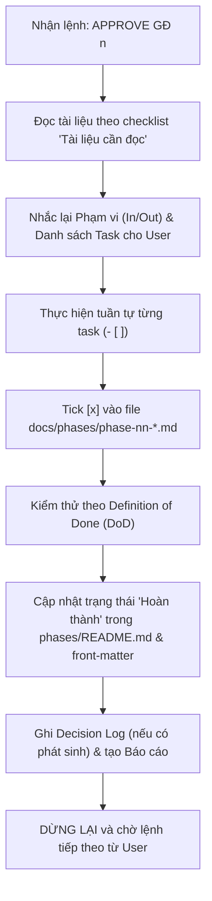

# Quy trình Làm việc & Phê duyệt của AI Agent (Workflow)
> File: `docs/rules/00-workflow.md`  
> Mô tả: Quy trình tiếp nhận lệnh phê duyệt `APPROVE GĐ <số>`, nguyên tắc dừng chờ duyệt, báo cáo kết quả và cách tick task.

---

## 1. Cơ chế Phê duyệt Từng Giai đoạn (Approval Mechanism)
1. **Chỉ code khi có lệnh phê duyệt tường minh:**
   - AI Agent chỉ được phép viết code ứng dụng, cài đặt thư viện hoặc chạy migration khi người dùng gửi chính xác cú pháp: `APPROVE GĐ <số>` (ví dụ: `APPROVE GĐ 4`).
   - Mọi yêu cầu khác không có cú pháp trên chỉ được trao đổi, phân tích hoặc cập nhật tài liệu thiết kế.
2. **Kỷ luật một giai đoạn:**
   - Mỗi lệnh `APPROVE GĐ <số>` chỉ cho phép thực hiện **đúng một giai đoạn duy nhất**.
   - Tuyệt đối không tự ý làm gộp hoặc làm trước sang các giai đoạn tiếp theo.

## 2. Quy trình Thực hiện Trước - Trong - Sau khi Code

### Bước 1: Kỷ luật trước khi code
- Đọc file giai đoạn tương ứng: `docs/phases/phase-nn-*.md`.
- Đọc **chính xác** các file được liệt kê trong mục `## Tài liệu cần đọc trước khi làm` của phase đó.
- Nhắc lại ngắn gọn phạm vi (In-Scope / Out-of-Scope) và danh sách task cho người dùng trước khi viết dòng code đầu tiên.

### Bước 2: Thực hiện theo Checklist
- Làm tuần tự theo từng task trong checklist `- [ ]`.
- Hoàn thành task nào thì tick `[x]` ngay vào file `docs/phases/phase-nn-*.md`.
- Tuyệt đối không tự ý thêm các tính năng ngoài checklist mà chưa có sự đồng thuận.

### Bước 3: Kiểm thử & Nghiệm thu theo DoD
- Thực hiện kiểm thử thủ công và tự động theo các tiêu chí trong mục `## Definition of Done (DoD) & Cách kiểm thử` của giai đoạn đó.
- Kiểm tra tính toàn vẹn hệ thống: không làm hỏng tính năng của các giai đoạn đã hoàn thành trước đó.

### Bước 4: Kỷ luật sau khi hoàn thành giai đoạn
- Cập nhật trạng thái của giai đoạn thành `Hoàn thành` trong:
  1. Front-matter của `docs/phases/phase-nn-*.md` (`status: Hoàn thành`).
  2. Bảng tổng hợp tiến độ tại `docs/phases/README.md`.
- Nếu có quyết định kỹ thuật mới phát sinh trong quá trình code, ghi nhận file mới tại `docs/decisions/DEC-XXX-<slug>.md` và cập nhật `docs/decisions/README.md`.
- Nếu có thay đổi cấu trúc dữ liệu, cập nhật file tương ứng trong `docs/data-model/`.
- Tạo file báo cáo kết thúc giai đoạn: `docs/reports/phase-nn-report.md`.
- Báo cáo kết quả ngắn gọn cho người dùng và **DỪNG LẠI** chờ lệnh tiếp theo. Không tự ý bước sang giai đoạn kế tiếp.

## 3. Xử lý Thay đổi & Điểm lệch Phạm vi
- Nếu phát hiện vấn đề kỹ thuật làm lệch phạm vi hoặc cần thay đổi kế hoạch ban đầu, AI Agent phải **dừng lại ngay lập tức** và hỏi ý kiến người dùng.
- Không tự suy diễn hoặc âm thầm triển khai các giải pháp đi ngược lại tài liệu kiến trúc.
- Ghi nhận các điểm nghi vấn vào `docs/open-questions.md`.

