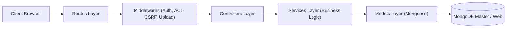

# Quy ước Chung trong Dự án (Conventions)
> File: `docs/rules/03-conventions.md`  
> Mô tả: Cấu trúc thư mục nguồn, quy ước đặt tên, phân tầng kiến trúc phần mềm, xử lý lỗi, logging và quy ước commit.

---

## 1. Cấu trúc Thư mục Dự án

```
Admin-CMS/
├── src/
│   ├── app.js                          # Cấu hình Express app, middleware pipeline
│   ├── server.js                       # Entry point kết nối DB và lắng nghe cổng HTTP
│   ├── config/                         # Cấu hình hệ thống (database, session, security, ribbon, constants)
│   ├── models/                         # Mongoose Models & Schemas (Item, PublishedItem, Template, User, Role, ACL...)
│   ├── routes/                         # Bộ định tuyến Express
│   │   ├── admin/                      # Routes cho giao diện quản trị Admin (EJS / Partial HTML / AJAX)
│   │   └── api/                        # RESTful Headless Delivery & Layout APIs
│   ├── controllers/                    # Tầng điều khiển tiếp nhận request, gọi service, render view / trả JSON
│   ├── services/                       # Tầng nghiệp vụ cốt lõi (Business Logic độc lập)
│   ├── middlewares/                    # Express Middlewares (auth, acl, csrf, validation, upload, error)
│   ├── utils/                          # Tiện ích bổ trợ (treeHelper, responseHelper, logger, diffHelper, cache)
│   ├── views/                          # Giao diện EJS (layouts, partials, admin screens)
│   └── public/                         # Tài sản tĩnh phía Client (css, js, vendor, images)
├── storage/                            # Thư mục lưu trữ tệp (không commit vào Git: uploads, thumbnails, temp)
├── tests/                              # Thư mục kiểm thử tự động (Unit / Integration / E2E)
├── docs/                               # Tài liệu kiến trúc và hướng dẫn vận hành
├── .env.example                        # Mẫu biến môi trường
├── package.json
└── AGENTS.md                           # Cổng vào chỉ dẫn dành cho AI Agent
```

---

## 2. Quy ước Đặt tên (Naming Conventions)

- **Tập tin mã nguồn JavaScript:** Sử dụng `camelCase` (ví dụ: `itemService.js`, `contentEditorController.js`, `presentationService.js`, `authMiddleware.js`).
- **Tập tin giao diện EJS:** Sử dụng `kebab-case` (ví dụ: `content-editor.ejs`, `item-form.ejs`, `media-picker.ejs`, `details-modal.ejs`).
- **Mongoose Models:** Sử dụng `PascalCase` danh từ số ít (ví dụ: `Item.js`, `Template.js`, `AuditLog.js`, `Role.js`).
- **Tên Collection MongoDB:** Sử dụng `snake_case` số nhiều (ví dụ: `items_master`, `items_web`, `templates`, `users`, `roles`, `audit_logs`).
- **Đường dẫn URL Routes:** Sử dụng `kebab-case` theo nguyên tắc RESTful (ví dụ: `/admin/content-editor`, `/admin/template-manager/create-field`).

---

## 3. Phân tầng Kiến trúc (Layered Architecture)



1. **Tầng Routes:** Chỉ định nghĩa URL path, HTTP Method và gán các Middlewares tương ứng. Không đặt logic xử lý trong file route.
2. **Tầng Controllers:** Tiếp nhận Request (params, query, body), gọi các hàm ở tầng Services xử lý, sau đó quyết định render View EJS hoặc trả về JSON chuẩn. **Tuyệt đối không viết câu lệnh truy vấn MongoDB trực tiếp trong Controller.**
3. **Tầng Services:** Chứa toàn bộ nghiệp vụ lõi (Business Logic). Tầng này độc lập hoàn toàn với HTTP request/response object (`req`, `res`). Cả Controller Admin và Controller Public API đều dùng chung Service để tái sử dụng logic.
4. **Tầng Models:** Khai báo cấu trúc bảng (Schema), kiểu dữ liệu, index, virtual fields, hooks (pre-save, post-save) của Mongoose.

---

## 4. Xử lý Lỗi, Validate Input và Logging

- **Lớp lỗi tùy biến `AppError`:**
  - Định nghĩa mã lỗi HTTP (`statusCode`), thông điệp (`message`), và mã lỗi nghiệp vụ (`errorCode`).
  - Phân loại lỗi:
    - `OperationalError`: Lỗi do người dùng nhập sai, không đủ quyền - hiển thị thông báo an toàn, dễ hiểu.
    - `SystemError`: Lỗi server, crash bất ngờ - log chi tiết stack trace và trả về thông báo lỗi hệ thống tổng quát.
- **Validate Input:** Mọi dữ liệu từ form POST và API đều phải được kiểm tra tính hợp lệ bằng schema validator trước khi xuống Service.
- **Logging:**
  - Sử dụng module logger Winston tập trung ghi nhận các mức: `INFO`, `WARN`, `ERROR`.
  - Môi trường Development: log có màu sắc ra console. Môi trường Production: xuất file log kèm rotation.

---

## 5. Quy ước Git Commit và Quản lý Nhánh

- **Cú pháp Commit:** `<type>(<scope>): <mô tả ngắn bằng tiếng Việt hoặc tiếng Anh>`
  - Types:
    - `feat`: Tính năng mới
    - `fix`: Sửa lỗi
    - `refactor`: Tối ưu mã nguồn không đổi hành vi
    - `docs`: Cập nhật tài liệu
    - `chore`: Cấu hình, cài đặt môi trường
  - Scope: Tên giai đoạn hoặc module (ví dụ: `gd0`, `gd2`, `presentation`, `acl`).
  - Ví dụ: `feat(gd6): bổ sung Presentation Details modal với SortableJS`

