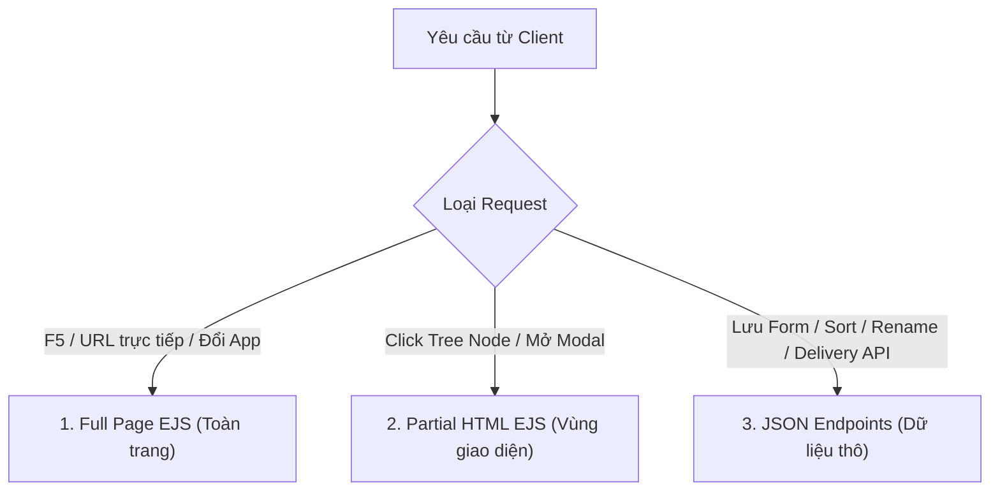

# Quy ước Định tuyến (Routing Conventions)
> File: `docs/rules/04-routing.md`  
> Mô tả: Phân định Full Page EJS vs Partial HTML EJS vs JSON Endpoints (Internal AJAX & Headless Layout Service).

---

## 1. Phân định Ba Loại Phản hồi HTTP (Response Types)
Để đạt trải nghiệm mượt mà giống Desktop App của Sitecore (nhanh, không giật màn hình) mà vẫn duy trì nền tảng SSR bảo mật:



### 1. Full Page EJS (`GET /admin/...`)
- **Đặc điểm:** Trả về toàn bộ trang HTML hoàn chỉnh (bao gồm Layout shell, Header, Ribbon bar, Content Tree, Workspace container, Taskbar).
- **Trường hợp sử dụng:**
  - Người dùng truy cập trực tiếp từ URL trình duyệt.
  - Nhấn F5 / Refresh trình duyệt.
  - Chuyển đổi giữa các ứng dụng trên Launchpad hoặc thanh Taskbar (ví dụ từ Content Editor sang Media Library).

### 2. Partial HTML EJS (`GET /admin/.../partial` hoặc Header `X-Requested-With: Partial`)
- **Đặc điểm:** Chỉ render và trả về một đoạn HTML của phân vùng giao diện cụ thể (không có header/taskbar bên ngoài).
- **Trường hợp sử dụng:**
  - Click vào một node trên Cây nội dung: client gửi AJAX lấy toàn bộ form chỉnh sửa `item-form.ejs` hoặc lưới thư mục `folder-view.ejs` và đưa thẳng vào `#editor-workspace` mà không reload trang.
  - Mở các cửa sổ modal phức tạp: ví dụ `GET /admin/content-editor/item/:id/presentation` trả về nội dung của `details-modal.ejs`, hoặc `GET /admin/media/picker` trả về modal picker chọn media.

### 3. JSON Endpoints
Chia làm 2 nhóm mục tiêu rõ ràng:

#### a. Internal AJAX Endpoints (`/admin/.../ajax` hoặc route nghiệp vụ admin)
- **Đặc điểm:** Trả về JSON phục vụ tương tác nhanh trên giao diện Content Editor.
- **Cấu trúc phản hồi chuẩn:**
  ```json
  {
    "success": true,
    "message": "Item saved successfully",
    "data": { ... }
  }
  ```
- **Ví dụ tiêu biểu:**
  - `POST /api/items`: Tạo item mới.
  - `PUT /api/items/:id/fields`: Lưu giá trị fields kèm Optimistic Locking (HTTP 409 khi xung đột).
  - `POST /api/items/:id/rename`: Đổi tên item và cập nhật path toàn bộ cây con.
  - `POST /api/items/:id/sort`: Sắp xếp thứ tự anh chị em (up, down, first, last).
  - `GET /api/items/:id/children`: Lazy-load các node con trả về cấu trúc Fancytree node format.
  - `POST /admin/content-editor/item/:id/presentation`: Lưu cấu hình Presentation.
  - `POST /admin/content-editor/item/:id/presentation/reset`: Reset về Standard Presentation.
  - `GET /admin/content-editor/item/:id/presentation/preview`: Trả về JSON layout preview.
  - `GET /api/media/folders`, `POST /api/media/folders`: Quản lý cây thư mục media.
  - `GET /api/media/assets`, `POST /api/media/upload`: Tải lên và duyệt danh sách media có phân trang/lọc.
  - `PUT /api/media/assets/:id`, `POST /api/media/move/:id`, `DELETE /api/media/assets/:id`: Cập nhật metadata, di chuyển và xóa media.
  - `GET /media/file/:id`: Phục vụ tệp tĩnh bảo mật kèm HTTP Cache-Control & ETag 304 (`?thumb=1` cho ảnh thu nhỏ).

#### b. Headless Delivery API & Layout Service (`/api/v1/...`)
- **Đặc điểm:** RESTful JSON dành riêng cho ứng dụng Frontend bên ngoài (React/Next.js/Mobile App), đọc dữ liệu độc quyền từ collection `items_web`.
- **Endpoints tiêu biểu:**
  - `GET /api/v1/content/item?path=...&lang=...`: Lấy dữ liệu nội dung thô theo Path.
  - `GET /api/v1/content/item/:id?lang=...`: Lấy nội dung thô theo ID.
  - `GET /api/v1/content/children/:id?lang=...`: Lấy danh sách con đã publish.
  - `GET /api/v1/layout?path=...&lang=...&device=...`: Headless Layout Service trả về route phân cấp, placeholders, components và datasource đã resolved.

