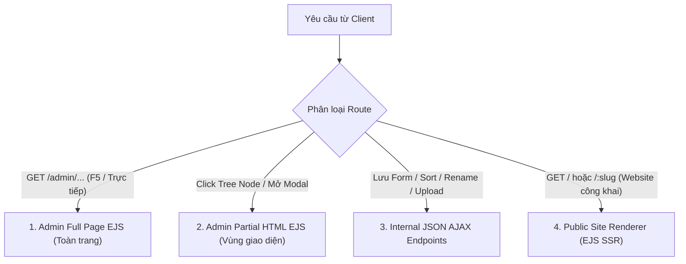

# Quy ước Định tuyến (Routing Conventions)
> File: `docs/rules/04-routing.md`  
> Mô tả: Phân định Admin Full Page EJS vs Partial HTML EJS vs Internal JSON Endpoints vs Public Site Renderer Routes.

---

## 1. Phân định Bốn Loại Tuyến Đường HTTP (Route Categories)
Dự án vận hành trên một ứng dụng Express.js thống nhất tại cổng 4000:



### 1. Admin Full Page EJS (`GET /admin/...`)
- **Đặc điểm:** Trả về toàn bộ trang HTML quản trị hoàn chỉnh (bao gồm Layout shell, Header, Ribbon bar, Content Tree, Workspace container, Taskbar).
- **Trường hợp sử dụng:**
  - Quản trị viên truy cập trực tiếp từ URL trình duyệt (`/admin/login`, `/admin/launchpad`, `/admin/content-editor`, `/admin/template-manager`, `/admin/media-library`).
  - Nhấn F5 / Refresh trình duyệt trong phân vùng quản trị.
  - Chuyển đổi giữa các ứng dụng trên Launchpad hoặc thanh Taskbar.

### 2. Admin Partial HTML EJS (`GET /admin/.../partial` hoặc Header `X-Requested-With: Partial`)
- **Đặc điểm:** Chỉ render và trả về một đoạn HTML của phân vùng giao diện cụ thể (không có header/taskbar bên ngoài).
- **Trường hợp sử dụng:**
  - Click vào một node trên Cây nội dung: client gửi AJAX lấy toàn bộ form chỉnh sửa `item-form.ejs` hoặc lưới thư mục `folder-view.ejs` và đưa thẳng vào `#editorWorkspace` mà không reload trang.
  - Mở các cửa sổ modal phức tạp: ví dụ `GET /admin/content-editor/item/:id/presentation` trả về nội dung của `details-modal.ejs`, hoặc `GET /admin/media/picker` trả về modal picker chọn media.

### 3. Internal JSON AJAX Endpoints (`/api/...`)
- **Đặc điểm:** Trả về JSON phục vụ tương tác nhanh và bất đồng bộ trên giao diện Content Editor / Template Manager / Media Library.
- **Cấu trúc phản hồi chuẩn:**
  ```json
  {
    "success": true,
    "message": "Item saved successfully",
    "data": { ... }
  }
  ```
- **Ví dụ tiêu biểu:**
  - `POST /api/items`: Tạo item mới.
  - `PUT /api/items/:id/fields`: Lưu giá trị fields kèm Optimistic Locking (HTTP 409 khi xung đột).
  - `POST /api/items/:id/rename`: Đổi tên item và cập nhật path toàn bộ cây con.
  - `POST /api/items/:id/sort`: Sắp xếp thứ tự anh chị em (up, down, first, last).
  - `GET /api/items/:id/children`: Lazy-load các node con trả về cấu trúc Fancytree node format.
  - `POST /admin/content-editor/item/:id/presentation`: Lưu cấu hình Presentation (Shared / Final Layout).
  - `POST /admin/content-editor/item/:id/presentation/reset`: Reset về Standard Presentation.
  - `GET /api/media/folders`, `POST /api/media/folders`: Quản lý cây thư mục media.
  - `GET /api/media/assets`, `POST /api/media/upload`: Tải lên và duyệt danh sách media có phân trang/lọc.
  - `PUT /api/media/:id`, `POST /api/media/:id/move`, `DELETE /api/media/:id`: Cập nhật metadata, di chuyển và xóa media.
  - `GET /media/file/:id`: Phục vụ tệp tĩnh bảo mật kèm HTTP Cache-Control & ETag 304 (`?thumb=1` cho ảnh thu nhỏ).

### 4. Public Site Renderer Routes (`/`, `/:slug`, `/:lang/:slug`)
- **Đặc điểm:** Tuyến đường công khai phục vụ người dùng cuối xem website chính thức, đọc dữ liệu hoàn toàn từ database `items_web` (sau khi đã publish từ Master).
- **Cơ chế hoạt động:**
  - `GET /`: Phân giải tới Start Item (node `Home` tại `/sitecore/content/Home`).
  - `GET /:slug` (ví dụ `/about-us`, `/news/company-announcement`): Phân giải segment theo cây nội dung `items_web`.
  - `GET /:lang/:slug` (ví dụ `/en/about-us`): Phục vụ phiên bản đa ngôn ngữ với ngôn ngữ mặc định là `vi` (không có prefix).
  - Trích xuất cấu hình Presentation (Layout EJS + Placeholder mappings + Rendering EJS components) và render 100% mã HTML ra trình duyệt.
  - Trang chưa publish hoặc bị xóa $\rightarrow$ trả về HTTP 404 (view `src/views/site/404.ejs`).

