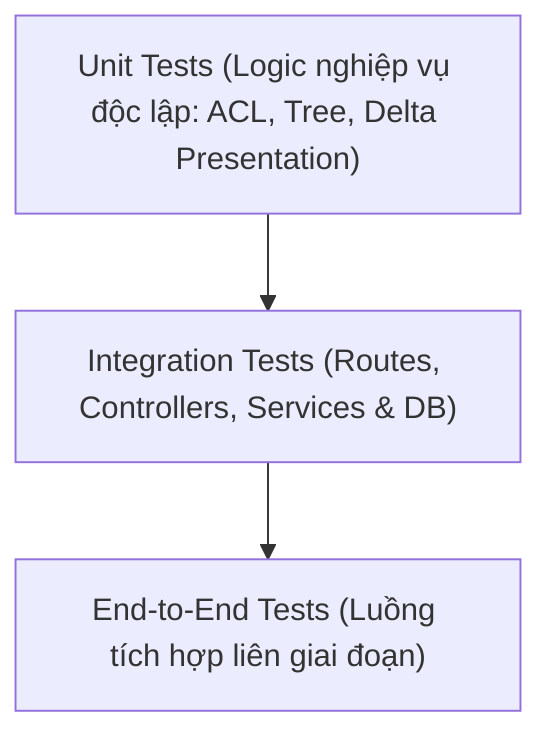

# Quy ước Kiểm thử & Tiêu chuẩn Hoàn thành (Testing & DoD)
> File: `docs/rules/06-testing.md`  
> Mô tả: Chiến lược kiểm thử tự động (Unit, Integration, E2E), tiêu chuẩn Definition of Done chung và nguyên tắc không hồi quy (No-Regression).

---

## 1. Chiến lược Kiểm thử (Testing Strategy)
Hệ thống áp dụng mô hình kim tự tháp kiểm thử (Testing Pyramid) với framework **Jest + Supertest**:

1. **Unit Tests (`tests/unit/`):**
   - Kiểm tra các hàm nghiệp vụ độc lập, không phụ thuộc I/O mạng hoặc database.
   - Trọng tâm:
     - `aclService.test.js`: Thuật toán tính quyền thừa kế Deny > Allow, quyền gán trực tiếp vs kế thừa.
     - `treeHelper.test.js`: Chuyển đổi dữ liệu phẳng sang node Fancytree, phát hiện vòng lặp cycle detection.
     - `presentationService.test.js`: Gộp Standard Presentation + Shared Layout + Final Layout delta override.
     - `diffHelper.test.js`: So sánh khác biệt giữa 2 phiên bản item.
2. **Integration Tests (`tests/integration/`):**
   - Kiểm tra sự phối hợp giữa Route, Middleware (Auth, CSRF, ACL), Controller, Service và MongoDB.
   - Trọng tâm: Luồng Auth -> CRUD Item -> Template Inheritance -> Workflow -> Publish sang Web.
3. **End-to-End Tests (`tests/e2e/`):**
   - Kiểm thử toàn vẹn luồng Server-Side EJS: Admin tạo Page từ Page Template -> Biên tập nội dung kế thừa từ Component Templates -> Cấu hình Presentation Details -> Chuyển Workflow & Publish -> Truy cập Public Site Renderer `GET /about-us` trả về HTML đúng layout và danh sách rendering EJS theo đúng thứ tự trong placeholder.

---

## 2. Tiêu chuẩn Hoàn thành Chung (General Definition of Done - DoD)
Một task hoặc một giai đoạn chỉ được đánh dấu hoàn thành khi thỏa mãn đầy đủ các điều kiện sau:
- [x] **Mã nguồn sạch & Chuẩn conventions:** Tuân thủ đúng phân tầng (Routes -> Controllers -> Services -> Models), không có câu lệnh DB trực tiếp trong controller, tên file/biến đúng quy ước.
- [x] **Bảo mật:** CSRF token được xác thực, đầu ra Rich Text được làm sạch qua `sanitize-html`, kiểm tra quyền `canPerform` trước mọi thao tác nhạy cảm.
- [x] **Không gây lỗi hồi quy (No-Regression):** Chạy lại toàn bộ test suite hiện có, bảo đảm 100% tests PASS và các chức năng của giai đoạn trước đó vẫn hoạt động bình thường.
- [x] **Kiểm thử thủ công theo kịch bản:** Thực hiện đầy đủ kịch bản kiểm thử mô tả trong mục DoD của file giai đoạn tương ứng.
- [x] **Tài liệu hóa:** Cập nhật bảng tiến độ trong `docs/phases/README.md`, tick `[x]` các task đã làm trong `docs/phases/phase-nn-*.md`, ghi nhận `Decision Log` nếu có phát sinh kiến trúc mới, và tạo file báo cáo `docs/reports/phase-nn-report.md`.

